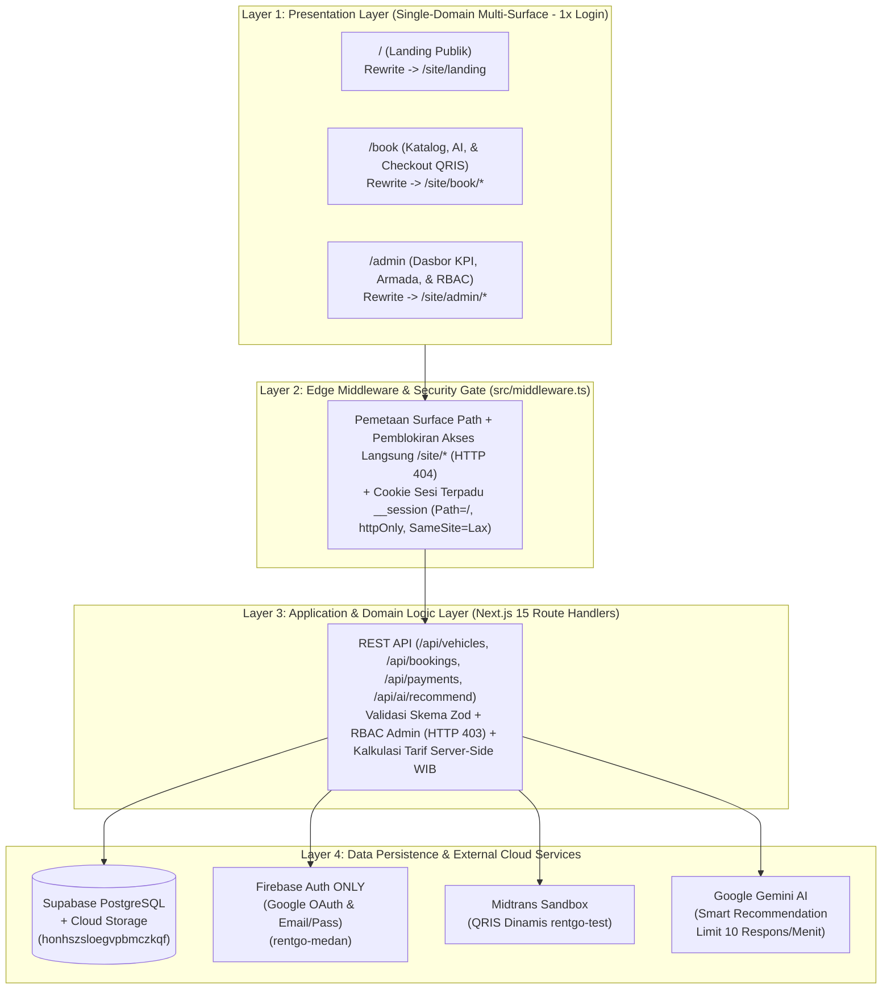

# RentGo Medan (v1.2.0) - Sistem Manajemen Penyewaan Kendaraan Real-Time Berbasis Web

Platform penyewaan mobil dan sepeda motor di Kota Medan, Bandara Internasional Kualanamu (KNO), Stasiun Kereta Api Medan, dan koridor wisata Sumatera Utara dengan **Arsitektur Single-Domain 1x Login (`rentgo.my.id/`, `/book`, `/admin`)**, pencegahan **Anti Double-Booking** tingkat transaksi basis data, pembayaran **QRIS Midtrans Sandbox (`rentgo-test`)**, serta asisten rekomendasi kendaraan **Google Gemini AI** (dibatasi 10 respons/menit).

---

## 1. Identitas Akademik (UTS MMPRPL)

| Atribut | Keterangan |
| :--- | :--- |
| **Nama Mahasiswa** | Akbar Riansyah |
| **Proyek Individu** | No. 2 - Sistem Manajemen Penyewaan Kendaraan (**RentGo Medan**) |
| **Mata Kuliah** | Metode Model Pengembangan Perangkat Lunak (MMPRPL) |
| **Program Studi / Semester** | Teknologi Rekayasa Perangkat Lunak (TRPL) - Semester III |
| **Institusi** | Politeknik Wilmar Bisnis Indonesia (WBI), Medan |
| **Metodologi SDLC** | **Incremental Model** (`v0.1.0` s/d `v1.2.0`) |
| **Repositori GitHub** | [https://github.com/rynnxz/rentGO.git](https://github.com/rynnxz/rentGO.git) |

---

## 2. Latar Belakang Masalah & Solusi Sistem

Operasional usaha penyewaan kendaraan di Kota Medan yang masih dikelola secara manual melalui pencatatan buku atau spreadsheet terpisah kerap menghadapi empat masalah kritis:
1. **Risiko Double-Booking:** Dua pelanggan memesan kendaraan berplat nomor `BK` yang sama pada rentang tanggal yang beririsan karena tidak adanya penguncian baris transaksi secara atomik.
2. **Ketidaksinkronan Jadwal Bengkel:** Unit yang sedang menjalani perawatan berkala (ganti oli, servis rem, spooring) tetap tampil di katalog pelanggan.
3. **Kalkulasi Tarif & Status Pesanan Tidak Terstandar:** Perhitungan durasi hari sewa inklusif dan verifikasi pembayaran QRIS tidak dikendalikan oleh *State Machine* yang baku.
4. **Kebingungan Pelanggan Memilih Armada:** Wisatawan kesulitan memilih spesifikasi kendaraan yang sesuai dengan jumlah penumpang, medan rute (seperti tanjakan Berastagi/Danau Toba atau touring motor berdua), dan anggaran harian.

**Solusi RentGo Medan v1.2.0:**
- **Anti Double-Booking Berlapis:** Validasi irisan tanggal inklusif (`existing.start_date <= req.end_date AND existing.end_date >= req.start_date`) terhadap pesanan aktif (`pending`, `confirmed`, `ongoing`) dan jadwal bengkel (`scheduled`, `in_progress`), diperkuat dengan `SELECT ... FOR UPDATE` dan constraint PostgreSQL `EXCLUDE USING gist`.
- **Single-Domain Multi-Surface (`1x Login`):** Seluruh permukaan aplikasi berjalan pada satu domain terpadu (`/` untuk Landing Page, `/book` untuk Aplikasi Pemesanan Pelanggan, dan `/admin` untuk Panel Operasional Admin) menggunakan satu sesi cookie `httpOnly` (`__session`).
- **Smart AI Recommendation (`Bantu Saya Pilih`):** Mengekstraksi maksud kueri bahasa alami Bahasa Indonesia (kategori mobil/motor, jumlah penumpang, dan batas anggaran) lalu memanggil model Google Gemini dengan validasi anti-halusinasi terhadap stok nyata dan pembatas laju (*rate limiter*) 10 respons per menit.

---

## 3. Arsitektur Sistem (Single-Domain & 4-Tier Layered Architecture)



---

## 4. Tech Stack & Integrasi Cloud

| Lapisan | Teknologi | Peran dalam Sistem |
| :--- | :--- | :--- |
| **Framework Utama** | Next.js 15.5 (App Router) + React 19 + TypeScript 5.8 (`strict`) | Full-stack rendering, API Route Handlers, dan Edge Middleware. |
| **Styling & UI** | Tailwind CSS 3.4 + Lucide Icons + Custom CSS Tokens | Implementasi **Teori Warna Triadik** (`60% Cobalt/Navy - 30% Emerald-Teal - 10% Warm Amber`) sesuai WCAG AA. |
| **Autentikasi** | Firebase Authentication (`rentgo-medan`) - **Auth-Only** | Login Google OAuth Popup, Email/Password, dan akun demo pengujian 1-klik tanpa ketergantungan Firestore. |
| **Database & Storage** | Supabase PostgreSQL + Storage (`honhszsloegvpbmczkqf`) + Dual-Mode Fallback | Menyimpan 7 tabel relasional, RPC transaksi `create_booking`, serta bucket `vehicles` & `payment-proofs` (dilengkapi fallback otomatis ke `.data/rentgo-local.json` saat offline). |
| **Pembayaran** | Midtrans Sandbox (`rentgo-test`) | Pembuatan payload QRIS Dinamis per kode booking dan simulasi pelunasan instan satu klik. |
| **Kecerdasan Buatan** | Google Gemini API (`gemini-3.5-flash-lite` / `gemini-flash-latest`) | Rekomendasi armada kontekstual dengan ekstraksi bahasa alami (mobil/motor, kursi, anggaran), *timeout* aman, dan *sliding window rate limit* 10 respons/menit. |
| **Pengujian Otomatis** | Vitest (Unit Test) + Playwright Chromium (E2E) | 21 unit test pada 5 file uji + 6 blok uji E2E yang mencakup 8 skenario (`E2E-01` s/d `E2E-08`) + 20 kasus uji Black-Box (`TC-001` s/d `TC-020`). |
| **Dek Presentasi** | Slidev (`@slidev/cli`) + Mermaid Diagrams | 15 slide presentasi akademik UTS interaktif di folder `slidev/`. |

---

## 5. Struktur Direktori Monorepo

```text
rentgo/
├── website/                  # Aplikasi utama Next.js 15 (Full-Stack App Router)
│   ├── src/
│   │   ├── app/              # Route handlers (/api/*) & halaman surface (/site/landing, /site/book, /site/admin)
│   │   ├── components/       # Komponen UI (shared/, book/, admin/)
│   │   ├── lib/              # Domain logic (pricing, availability, booking-state, ai, repository, supabase, firebase)
│   │   └── middleware.ts     # Single-Domain routing & pemblokiran /site/* (HTTP 404)
│   ├── supabase/             # Skrip SQL (RENTGO_FULL_SETUP_AND_SEED.sql & migrations/0001_init.sql)
│   └── tests/                # Pengujian otomatis (tests/unit/*.test.ts & tests/e2e/rentgo.spec.ts)
├── slidev/                   # Dek presentasi akademik UTS (15 slide di slides.md)
├── audit/                    # 5 dokumen audit komprehensif sistem (Profil, Arsitektur, ERD, Pengujian Black-Box)
├── laporan/                  # Laporan akhir UTS MMPRPL (LAPORAN_UTS_RENTGO.md) & tangkapan layar bukti (screenshots/)
└── docs/                     # Panduan langkah manual (MANUAL_STEPS.md), skenario demo (DEMO_SCRIPT.md), & bukti uji (evidence/)
```

---

## 6. Cara Menjalankan Aplikasi Secara Lokal

### Prasyarat
- **Node.js** versi `20.x` atau lebih baru
- **npm** versi `10.x` atau lebih baru

### Langkah Instalasi & Menjalankan Server
```bash
# 1. Masuk ke direktori aplikasi web
cd website

# 2. Instal seluruh dependensi
npm install

# 3. Salin template environment variables dan isi kunci API Anda
cp .env.example .env.local

# 4. Jalankan server pengembangan (http://localhost:3000)
npm run dev
```

Setelah server aktif, buka di browser:
- **Landing Page Publik:** `http://localhost:3000/`
- **Aplikasi Pemesanan & Asisten AI:** `http://localhost:3000/book`
- **Panel Operasional Admin:** `http://localhost:3000/admin`

> **Catatan Mode Database Dual-Mode:** Jika variabel `SUPABASE_SERVICE_ROLE_KEY` diisi dan skrip `website/supabase/RENTGO_FULL_SETUP_AND_SEED.sql` telah dijalankan di Supabase SQL Editor, aplikasi otomatis menggunakan **Supabase Cloud (`supabase-cloud`)**. Jika belum dikonfigurasi atau sedang tanpa internet, aplikasi otomatis berjalan mulus menggunakan penyimpanan lokal terseed di `website/.data/rentgo-local.json` (**`local-fallback`**).

---

## 7. Cara Menjalankan Pengujian Otomatis & Slidev

```bash
cd website

# 1. Pemeriksaan tipe statis TypeScript (0 error)
npm run typecheck

# 2. Menjalankan 21 Unit Test & Concurrency Test (Vitest - 5 file uji)
npm test

# 3. Memvalidasi Production Build Next.js
npm run build

# 4. Menjalankan 6 Blok Uji / 8 Skenario End-to-End Browser (Playwright Chromium)
npx playwright test
```

Untuk menjalankan atau mem-build dek presentasi **Slidev**:
```bash
cd slidev
npm install
npm run dev     # Membuka server presentasi interaktif
npm run build   # Mem-build SPA statis presentasi ke slidev/dist
```

---

## 8. Tautan Dokumen Penting & Bukti Proyek

- **Laporan Akhir UTS MMPRPL:** [laporan/LAPORAN_UTS_RENTGO.md](file:///c:/uts-mmprpl/rentgo/laporan/LAPORAN_UTS_RENTGO.md)
- **Indeks Audit Teknis Sistem:** [audit/README.md](file:///c:/uts-mmprpl/rentgo/audit/README.md)
  - [01 - Profil & Fitur Aplikasi](file:///c:/uts-mmprpl/rentgo/audit/01-profil-dan-fitur-aplikasi.md)
  - [02 - Arsitektur & Penghubung Sistem](file:///c:/uts-mmprpl/rentgo/audit/02-arsitektur-dan-penghubung-sistem.md)
  - [03 - ERD & Relasi Database Supabase](file:///c:/uts-mmprpl/rentgo/audit/03-erd-dan-relasi-database.md)
  - [04 - Audit Pengujian & Panduan Black-Box](file:///c:/uts-mmprpl/rentgo/audit/04-audit-pengujian-dan-blackbox.md)
- **Panduan Konfigurasi Cloud Manual & Rotasi Kunci:** [docs/MANUAL_STEPS.md](file:///c:/uts-mmprpl/rentgo/docs/MANUAL_STEPS.md)
- **Naskah Demo Presentasi (3-5 Menit):** [docs/DEMO_SCRIPT.md](file:///c:/uts-mmprpl/rentgo/docs/DEMO_SCRIPT.md)
- **Catatan Rilis v1.2.0:** [docs/RELEASE_NOTES_v1.2.0.md](file:///c:/uts-mmprpl/rentgo/docs/RELEASE_NOTES_v1.2.0.md)
- **Bukti Pengujian & Verifikasi:**
  - [docs/evidence/test-results.md](file:///c:/uts-mmprpl/rentgo/docs/evidence/test-results.md)
  - [docs/evidence/supabase-verification.md](file:///c:/uts-mmprpl/rentgo/docs/evidence/supabase-verification.md)
  - [docs/evidence/deploy-smoke-test.md](file:///c:/uts-mmprpl/rentgo/docs/evidence/deploy-smoke-test.md)
