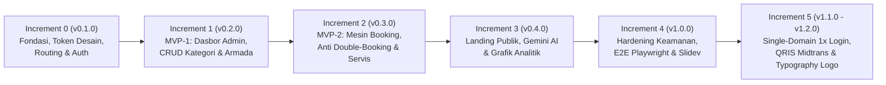

# 01 - Audit Profil Aplikasi, Metodologi SDLC, dan Fitur RentGo Medan

## 1. Aplikasi Apa Ini? (Deskripsi Sistem)

**RentGo Medan** adalah **Sistem Manajemen Penyewaan Kendaraan Real-Time Berbasis Web** yang dirancang khusus untuk operasional penyewaan mobil dan sepeda motor di **Kota Medan, Bandara Internasional Kualanamu (KNO), Stasiun Kereta Api Medan, serta rute wisata Berastagi dan Danau Toba**.

Proyek ini dikembangkan sebagai **Proyek Individu UTS No. 2** pada mata kuliah **Metode & Model Pengembangan Perangkat Lunak (MMPRPL)** di Program Studi Teknologi Rekayasa Perangkat Lunak (TRPL), Politeknik Wilmar Bisnis Indonesia oleh **Akbar Riansyah**.

### Masalah Utama yang Diselesaikan oleh RentGo Medan
1. **Pencegahan Bentrok Jadwal (*Double-Booking*):** Usaha rental konvensional yang mencatat pesanan lewat chat WhatsApp atau buku manual sering mengalami bentrok di mana 1 mobil yang sama dijanjikan ke 2 pelanggan berbeda pada tanggal yang beririsan. RentGo mengunci jadwal secara atomik di tingkat database.
2. **Ketidaksinkronan Jadwal Servis Bengkel dengan Katalog Pelanggan:** Kendaraan yang sedang ganti oli atau turun mesin sering kali masih tampil sebagai unit tersedia di katalog. Di RentGo, setiap unit yang masuk jadwal perawatan (`scheduled` / `in_progress`) otomatis disembunyikan dari pencarian tanggal sewa pelanggan.
3. **Kesulitan Pelanggan Memilih Armada Sesuai Medan Jalan & Anggaran:** Wisatawan luar kota sering bingung memilih antara City Car, MPV 7 kursi, SUV tanjakan (untuk rute Tele/Samosir), atau Hiace rombongan. RentGo menyediakan asisten **Google Gemini AI ("Bantu Saya Pilih")** yang hanya merekomendasikan kendaraan nyata yang berstatus tersedia pada tanggal pilihan pelanggan.
4. **Ketidakjelasan Status Pembayaran & Pesanan Menggantung:** RentGo menyediakan simulasi pembayaran **QRIS Midtrans Sandbox (`rentgo-test`)** dengan tombol konfirmasi instan **"Sudah Bayar"**, unggah bukti tangkapan layar ke Cloud Storage, serta masa kedaluwarsa otomatis 24 jam (`expires_at`) bagi pesanan `pending` yang belum dibayar.

---

## 2. Metodologi Pengembangan: SDLC Incremental Model

RentGo Medan dibangun menggunakan **Incremental Software Development Life Cycle (SDLC)** yang dibagi menjadi tahapan rilis bertahap (*increment*). Setiap increment melewati tahapan mini-waterfall: **Analisis Kebutuhan -> Perancangan -> Implementasi -> Pengujian -> Deployment/Rilis**.

---

## 3. Identitas Visual: Logo Typography & Teori Warna Triadik

### 3.1 Desain Logo Typography (Wordmark Editorial)
Sesuai evaluasi estetika terbaru pada rilis `v1.2.0`, logo RentGo ([logo.tsx](file:///c:/uts-mmprpl/rentgo/website/src/components/shared/logo.tsx)) dirancang ulang menggunakan pendekatan **Pure Editorial Typography Wordmark** tanpa ikon mobil klise:
- **Elemen Aksen Kecepatan Triadik:** Tiga bilah miring (`-skew-x-12`) berwarna **Royal Blue (`#1D4ED8`)**, **Emerald (`#059669`)**, dan **Amber (`#D97706`)** di sisi kiri yang melambangkan presisi jadwal dan pergerakan armada.
- **Tipografi Kontras Tinggi (`RENT` + `GO.`):** Kata `RENT` menggunakan bobot ekstra tebal (`font-black`) tegak yang melambangkan ketegasan kontrak sewa, dipadukan dengan kata `GO` miring (`italic`) berwarna aksen dinamis dan titik **Emerald** di akhir sebagai penanda kesiapan jalan.
- **Tag Monospace `MDN`:** Lencana kode wilayah Medan/Kualanamu dengan garis bawah triadik 3 warna.

### 3.2 Sistem Warna Triadik (Triadic Color Harmony)
Seluruh antarmuka web (`src/styles/tokens.css`) dan slide presentasi (`slidev/style.css`) mematuhi harmoni **3 titik warna Triadik** yang berjarak seimbang pada roda warna:
1. **Primary - Royal Navy Blue (`#1D4ED8` & `#0B1F3A`):** Merepresentasikan kepercayaan, keamanan transaksi, struktur navigasi utama, dan header modal.
2. **Secondary - Emerald Jade (`#059669` & `#047857`):** Merepresentasikan status unit siap jalan (*Tersedia*), verifikasi pembayaran QRIS Lunas, dan lencana sistem terverifikasi.
3. **Accent - Warm Amber Gold (`#D97706` & `#F59E0B`):** Merepresentasikan tombol konversi utama (*CTA*), indikator perhatian (*Pending*), dan aksen aktif pada sidebar.

---

## 4. Rincian Fitur pada 3 Permukaan Aplikasi

Seluruh fitur disajikan dalam **1 domain terpadu (`rentgo.my.id` / `localhost:3000`)** yang terbagi menjadi 3 permukaan (*surfaces*):

### A. Permukaan Publik / Landing Page (`/`)
- **Hero Pencarian Cepat:** Formulir tanggal mulai (WIB), tanggal selesai (WIB), dan kategori yang langsung mengarahkan pengguna ke katalog `/book` dengan filter aktif.
- **Showcase Foto Armada Asli:** Menampilkan foto unit nyata dari `public/vehicles/` (Toyota Avanza 1.5 G CVT, Honda Brio Satya RS, Yamaha NMAX 155 Connected, Toyota Agya GR Sport, Daihatsu Xenia, Honda Vario 160 ABS) dengan fallback ilustrasi SVG untuk unit lainnya.
- **4 Keunggulan Operasional, 3 Langkah Cara Sewa, Tabel Transparansi Tarif Harian, FAQ, dan Integrasi WhatsApp Admin.**

### B. Permukaan Pelanggan / Booking App (`/book`)
- **Mesin Pencarian Ketersediaan Real-Time (`/book`):** Hanya menampilkan kendaraan berstatus `active` yang tidak memiliki booking aktif (`pending`, `confirmed`, `ongoing`) maupun jadwal perawatan (`scheduled`, `in_progress`) pada rentang tanggal yang dipilih.
- **Asisten Rekomendasi Gemini AI ("Bantu Saya Pilih"):** Menerima input bahasa alami pelanggan, dibatasi maksimal **10 respons per menit** (sliding-window rate limiter), dan mengembalikan 3 unit terbaik beserta persentase kecocokan (`fit_score`).
- **Halaman Detail & Kalkulator Checkout (`/book/vehicles/[id]`):** Menghitung durasi sewa inklusif `(end_date - start_date) + 1 hari` secara otomatis dan memvalidasi Nomor WhatsApp serta Nomor SIM A/C.
- **Simulasi Pembayaran QRIS Midtrans Sandbox (`/book/bookings/[id]`):** Menampilkan kode QRIS dinamis (`rentgo-test`), tombol **"Sudah Bayar (Simulasi Sandbox Instan)"**, fitur unggah tangkapan layar bukti bayar, serta pembatalan mandiri selama status masih `pending`.
- **Manajemen Profil & SIM (`/book/profile`):** Menyimpan Nomor HP dan Nomor SIM pelanggan agar otomatis terisi pada pemesanan berikutnya.

### C. Permukaan Administrator / Panel Operasional (`/admin`)
- **Role-Based Access Control (RBAC) Ketat:** Hanya akun dengan peran `admin` (seperti `akbarriansyah339@gmail.com`) yang dapat membuka `/admin`. Pengguna belum login diarahkan ke gerbang autentikasi, sedangkan pelanggan (`customer`) menerima halaman **HTTP 403 - Akses Ditolak**.
- **Dasbor Operasional (`/admin`):** Menampilkan 6 kartu KPI, Grafik Pendapatan 6 Bulan, Top 5 Armada Terlaris, Matriks Kalender Ketersediaan 7 Hari, dan Tabel Transaksi Terbaru.
- **CRUD Kategori (`/admin/categories`) & CRUD Kendaraan (`/admin/vehicles`):** Pencarian, filter, paginasi, unggah foto ke Supabase Cloud Storage, dan *soft-delete* (`deleted_at`).
- **Manajemen Pesanan & Menu Aksi Satu Baris (`/admin/bookings`):** Baris tabel menampilkan tombol aksi utama (`Set Lunas` dan status berikutnya) ditambah tombol **"Semua Aksi (+N)"** yang membuka modal detail untuk transisi status lengkap (`Konfirmasi`, `Mulai Sewa`, `Selesaikan`, `Batalkan`, `Tolak`, `Kedaluwarsa`), verifikasi pembayaran QRIS, dan ekspor laporan CSV.
- **Manajemen Perawatan Bengkel (`/admin/maintenance`) & Manajemen Pelanggan (`/admin/customers`).**
