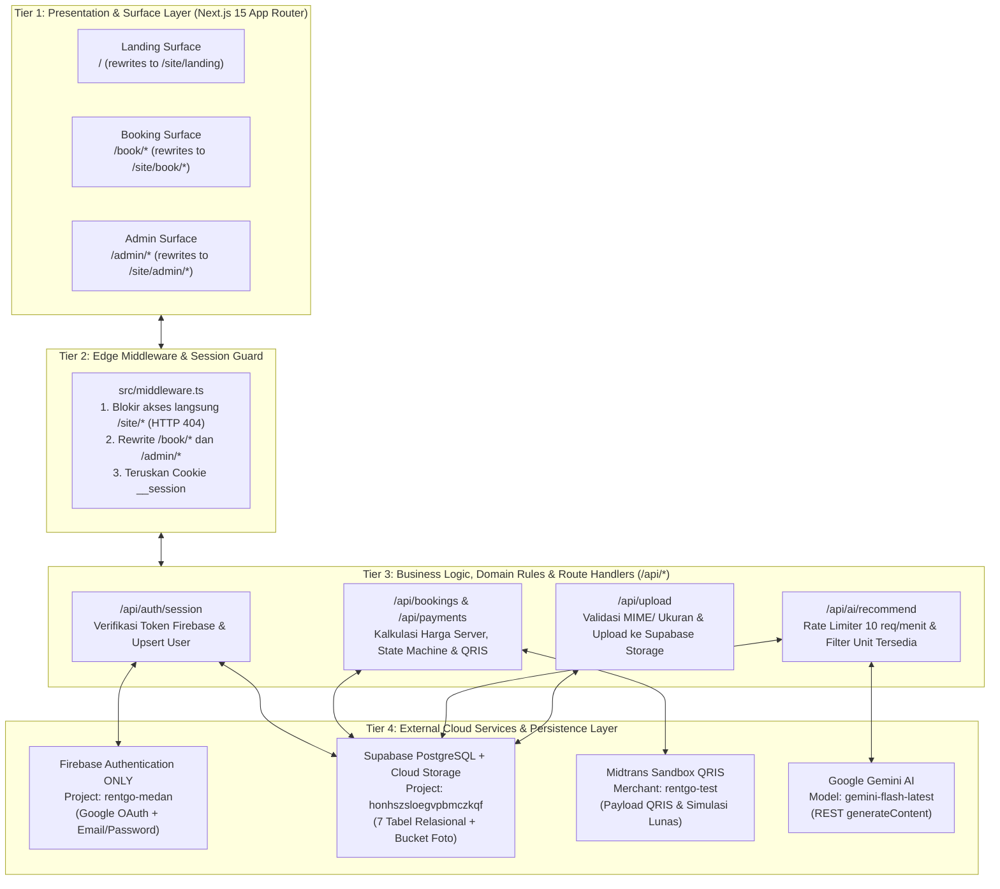
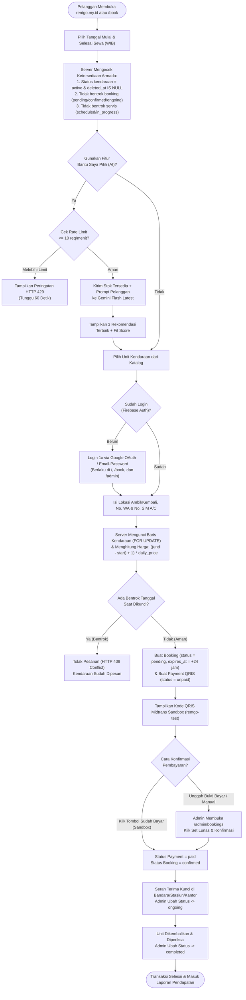

# 02 - Audit Arsitektur Sistem, Penghubung Antar-Layanan, & Flowchart

## 1. Arsitektur Utama: Single-Domain Multi-Surface (`rentgo.my.id/`, `/book`, `/admin`)

### Mengapa Diubah dari Multi-Subdomain ke Single-Domain Path Architecture?
Pada arsitektur multi-subdomain (`book.localhost` dan `admin.localhost`), peramban (*browser*) mengisolasi penyimpanan sesi lokal (`IndexedDB` / `localStorage` milik Firebase Auth SDK) dan cookie host-only di setiap subdomain. Akibatnya, ketika pengguna sudah login di halaman utama atau katalog booking lalu berpindah ke panel admin, pengguna dipaksa untuk login ulang.

Pada rilis **`v1.2.0`**, arsitektur diperbarui menjadi **Single-Domain Multi-Surface Path Architecture** di bawah satu domain tunggal (`rentgo.my.id` di produksi dan `localhost:3000` di lokal):

| Permukaan (Surface) | URL Publik (Single Origin) | Rewrite Internal (`src/middleware.ts`) | Hak Akses & Sesi |
|---|---|---|---|
| **1. Landing Publik** | `rentgo.my.id/` (`localhost:3000/`) | `/site/landing` | Publik + berbagi sesi login yang sama |
| **2. Aplikasi Booking** | `rentgo.my.id/book` (`localhost:3000/book/*`) | `/site/book/*` | Publik (Katalog/AI) & Customer/Admin (Checkout) |
| **3. Panel Admin** | `rentgo.my.id/admin` (`localhost:3000/admin/*`) | `/site/admin/*` | Wajib Login Role `admin` (Customer ditolak HTTP 403) |

**Keunggulan Utama (1x Login untuk Semua Halaman):**
Karena `/`, `/book`, dan `/admin` berada pada *origin* yang 100% sama, cookie sesi `__session` (`Path=/`, `HttpOnly`, `SameSite=Lax`) serta state Firebase Auth langsung berlaku di ketiga permukaan. Pengguna cukup **login 1 kali saja** dan dapat berpindah antara Beranda (`/`), Katalog Booking (`/book`), dan Panel Admin (`/admin`) tanpa pernah diminta login ulang.

---

## 2. Arsitektur Berlapis 4-Tier (4-Tier Layered Architecture)

Secara struktural, kode aplikasi di dalam `website/src/` menerapkan pemisahan tanggung jawab 4 lapis (*4-Tier Architecture*):

---

## 3. Pembagian Peran & Penghubung Antar-Arsitektur (Inter-Service Connectors)

Tabel berikut menjelaskan secara rinci **peran masing-masing layanan eksternal** dan bagaimana aplikasi menghubungkannya:

| Layanan Eksternal | Peran Spesifik di RentGo Medan | File Konektor / Integrasi | Protokol & Mekanisme Penghubung |
|---|---|---|---|
| **1. Firebase (`rentgo-medan`)** | **KHUSUS AUTENTIKASI (Auth-Only).** Tidak digunakan untuk database (Firestore dinonaktifkan). Menangani Google Sign-In OAuth Popup dan Email/Password Authentication. | [firebase-client.ts](file:///c:/uts-mmprpl/rentgo/website/src/lib/firebase-client.ts), [auth-controls.tsx](file:///c:/uts-mmprpl/rentgo/website/src/components/shared/auth-controls.tsx), [session.ts](file:///c:/uts-mmprpl/rentgo/website/src/lib/session.ts) | Client memanggil `signInWithPopup` / `signInWithEmailAndPassword` -> mengirim ID Token ke `POST /api/auth/session` -> Server menerbitkan cookie `__session` (`HttpOnly`) dan menyinkronkan profil pengguna ke tabel `users` di Supabase. |
| **2. Supabase (`honhszsloegvpbmczkqf`)** | **PUSAT DATABASE RELASIONAL & CLOUD STORAGE.** Menyimpan 7 tabel PostgreSQL (`users`, `vehicle_categories`, `vehicles`, `bookings`, `payments`, `maintenance_logs`, `ai_recommendation_logs`) dan 2 bucket file (`vehicles`, `payment-proofs`). | [repository.ts](file:///c:/uts-mmprpl/rentgo/website/src/lib/repository.ts), [route.ts (upload)](file:///c:/uts-mmprpl/rentgo/website/src/app/api/upload/route.ts) | Server berkomunikasi via `@supabase/supabase-js` dengan RLS aktif. Dilengkapi *Dual-Mode Persistence*: jika tabel Supabase sudah diinisialisasi, data disimpan di cloud Supabase; jika sedang diuji offline/CI, otomatis menggunakan penyimpanan atomik lokal `.data/rentgo-local.json`. |
| **3. Midtrans Sandbox (`rentgo-test`)** | **GATEWAY PEMBAYARAN QRIS SANDBOX.** Menghasilkan kode QRIS standar EMVCo dan simulasi penyelesaian pembayaran instan. | [booking-detail-client.tsx](file:///c:/uts-mmprpl/rentgo/website/src/components/book/booking-detail-client.tsx), [route.ts (payments)](file:///c:/uts-mmprpl/rentgo/website/src/app/api/payments/%5BbookingId%5D/route.ts) | Saat pesanan dibuat dengan metode `qris`, halaman detail merender QRIS Midtrans Sandbox (`rentgo-test`). Pelanggan dapat mengunggah bukti bayar atau menekan tombol **"Sudah Bayar (Simulasi Sandbox Instan)"** yang memanggil `PATCH /api/payments/[bookingId]` (`simulate_qris_paid: true`) untuk melunasi tagihan dan mengonfirmasi pesanan. |
| **4. Google Gemini AI (`gemini-flash-latest`)** | **ENGINE REKOMENDASI ARMADA CERDAS.** Menganalisis kebutuhan perjalanan bahasa alami dan mencocokkannya dengan stok armada yang benar-benar tersedia. | [ai-recommend.ts](file:///c:/uts-mmprpl/rentgo/website/src/lib/ai-recommend.ts), [route.ts (ai)](file:///c:/uts-mmprpl/rentgo/website/src/app/api/ai/recommend/route.ts) | Server mengecek *sliding-window rate limiter* (**maksimal 10 respons/menit**), mengambil daftar unit yang tersedia dari database, lalu memanggil endpoint `POST https://generativelanguage.googleapis.com/v1beta/models/gemini-flash-latest:generateContent` dengan header `X-goog-api-key`. Hasil rekomendasi divalidasi dengan daftar ID armada nyata (anti-halusinasi) dan dicatat ke `ai_recommendation_logs`. |

---

## 4. Flowchart Alur Bisnis End-to-End (Pelanggan & Admin)

Diagram alir (*Flowchart*) berikut menggambarkan siklus hidup penyewaan kendaraan dari pencarian hingga penyelesaian sewa:

