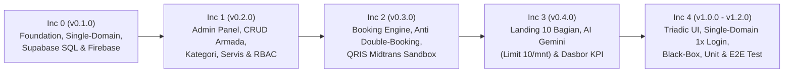
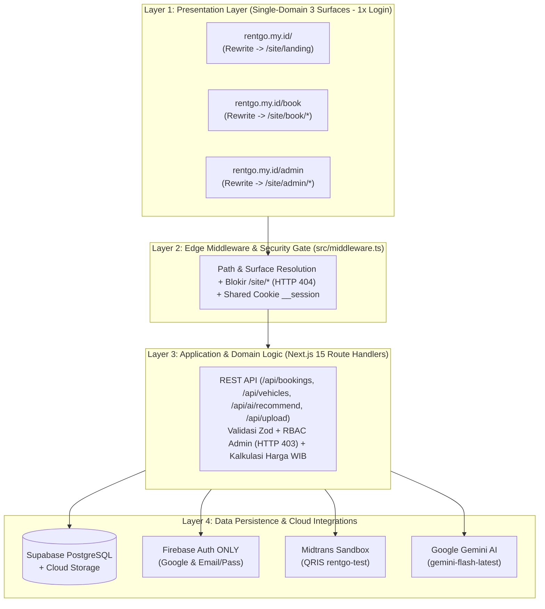
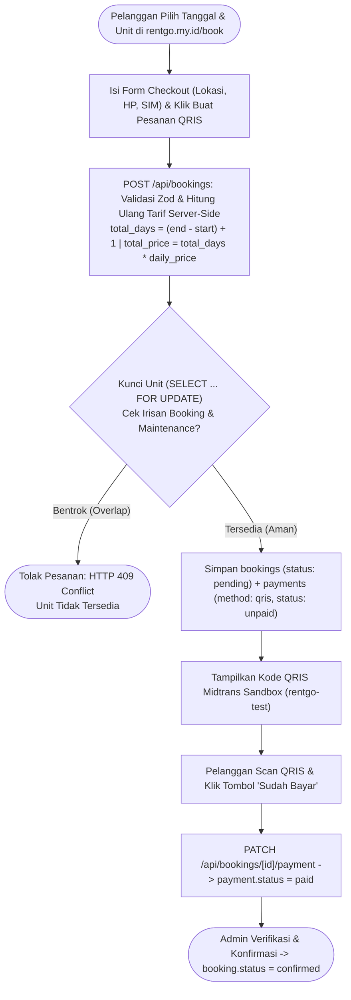
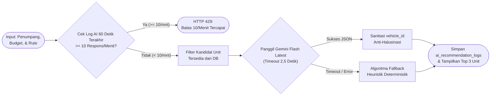

# RentGo Medan
## Sistem Manajemen Penyewaan Kendaraan Berbasis Web dengan Metodologi SDLC Incremental

<div class="mt-4 grid grid-cols-2 gap-4 text-xs">
  <div class="rentgo-card">
    <p class="font-bold uppercase" style="color: var(--primary-600)">Identitas Akademik UTS</p>
    <p class="mt-1.5"><strong>Nama Mahasiswa:</strong> Akbar Riansyah</p>
    <p><strong>Proyek Individu:</strong> No. 2 - Penyewaan Kendaraan</p>
    <p><strong>Mata Kuliah:</strong> Metode Model Pengembangan Perangkat Lunak</p>
    <p><strong>Program Studi:</strong> TRPL Semester III - Politeknik Wilmar Bisnis Indonesia</p>
  </div>
  <div class="rentgo-card">
    <p class="font-bold uppercase" style="color: var(--secondary-700)">Arsitektur Single-Domain (1x Login) & Integrasi Cloud</p>
    <p class="mt-1.5"><code>rentgo.my.id/</code> : Landing Publik & Transparansi Tarif</p>
    <p><code>rentgo.my.id/book</code> : Katalog Real-Time, AI Gemini, & QRIS</p>
    <p><code>rentgo.my.id/admin</code> : Dasbor KPI, Armada, Servis, & RBAC</p>
    <p class="mt-1 font-semibold" style="color: var(--accent-600)">Stack: Next.js 15 + Supabase + Firebase Auth + Midtrans QRIS + Gemini AI</p>
  </div>
</div>

---

# 1. Latar Belakang & Rumusan Masalah

Operasional usaha rental mobil dan motor di Kota Medan (Bandara Kualanamu, Stasiun Medan, dan rute wisata Danau Toba) sering menghadapi 4 kendala utama ketika masih dikelola via buku tulis atau spreadsheet terpisah:

<div class="mt-3 grid grid-cols-2 gap-3 text-xs">
  <div class="rentgo-card">
    <h3 class="text-sm font-bold">1. Risiko Double-Booking</h3>
    <p class="mt-1" style="color: var(--slate-600)">Dua pelanggan memesan unit plat BK yang sama pada tanggal beririsan karena pencatatan jadwal tidak dikunci secara atomik di tingkat transaksi database.</p>
  </div>
  <div class="rentgo-card">
    <h3 class="text-sm font-bold">2. Ketidaksinkronan Jadwal Bengkel</h3>
    <p class="mt-1" style="color: var(--slate-600)">Kendaraan yang sedang ganti oli atau servis rem tetap ditawarkan ke pelanggan karena data perawatan bengkel terpisah dari katalog sewa.</p>
  </div>
  <div class="rentgo-card">
    <h3 class="text-sm font-bold">3. Verifikasi Pembayaran Tidak Terstandar</h3>
    <p class="mt-1" style="color: var(--slate-600)">Perhitungan durasi hari sewa inklusif dan pembayaran QRIS tidak terhubung ke state machine pesanan yang baku.</p>
  </div>
  <div class="rentgo-card">
    <h3 class="text-sm font-bold">4. Kebingungan Memilih Unit Armada</h3>
    <p class="mt-1" style="color: var(--slate-600)">Wisatawan sering kesulitan menentukan unit yang tepat antara City Car, MPV 7 kursi, SUV tanjakan Berastagi, atau Motor Matik.</p>
  </div>
</div>

---

# 2. Metodologi SDLC Incremental & Peta Jalan Rilis



| Kriteria Evaluasi | Waterfall | Prototype | Agile Scrum | **SDLC Incremental (Dipilih)** |
| :--- | :--- | :--- | :--- | :--- |
| **Rilis Perangkat Lunak Kerja** | Hanya di akhir proyek | Fokus UI semu | Tiap sprint (butuh tim) | **Bertahap tiap Increment (`v0.1.0`..`v1.2.0`)** |
| **Mitigasi Risiko Anti Double-Booking** | Terlambat diuji | Tidak menguji DB | Baik | **Diuji penuh sejak Increment 2 (`v0.3.0`)** |
| **Kesesuaian Proyek Individu UTS** | Terlalu kaku | Kurang kokoh di backend | Overhead seremonial tim | **Ideal untuk pengembang tunggal terstruktur** |

---

# 3. Sistem Desain & Teori Warna Triadik

Identitas visual **RentGo Medan** dirancang menggunakan **Teori Warna Triadik** (3 titik berjarak 120 derajat pada roda warna) dengan rasio **60% - 30% - 10%** serta kontras terverifikasi **WCAG AA**:

<div class="mt-2 grid grid-cols-3 gap-3 text-xs">
  <div class="rentgo-card-triad-1">
    <span class="rentgo-badge" style="background:#1D4ED8;color:#fff">Triad I (220°) - 60% Dominan</span>
    <h3 class="mt-1.5 text-sm font-bold">Cobalt & Deep Navy</h3>
    <p class="mt-1 font-mono text-[11px]">#0B1D3A | #1D4ED8 | #EFF6FF</p>
    <p class="mt-1" style="color: var(--slate-600)">Struktur navigasi sticky, sidebar Admin, tipografi utama, dan tombol aksi primer.</p>
  </div>
  <div class="rentgo-card-triad-2">
    <span class="rentgo-badge-teal">Triad II (172°) - 30% Sekunder</span>
    <h3 class="mt-1.5 text-sm font-bold">Emerald-Teal</h3>
    <p class="mt-1 font-mono text-[11px]">#0F766E | #0D9488 | #F0FDFA</p>
    <p class="mt-1" style="color: var(--slate-600)">Indikator ketersediaan armada real-time, status lunas QRIS Midtrans, dan upload cloud.</p>
  </div>
  <div class="rentgo-card-triad-3">
    <span class="rentgo-badge">Triad III (38°) - 10% Aksen</span>
    <h3 class="mt-1.5 text-sm font-bold">Warm Amber-Gold</h3>
    <p class="mt-1 font-mono text-[11px]">#B45309 | #F59E0B | #FFFBEB</p>
    <p class="mt-1" style="color: var(--slate-600)">Aksen bilah kecepatan Logo Typography, badge rekomendasi AI Gemini, dan aksi Edit armada.</p>
  </div>
</div>

<div class="mt-3 rentgo-card text-xs">
  <strong>Perbaikan UI/UX & Arsitektur v1.2.0:</strong> (1) <strong>Logo Typography Editorial (`RENTGO. MDN`)</strong>, (2) <strong>Arsitektur Single-Domain (`rentgo.my.id/`, `/book`, `/admin`)</strong> agar cukup <strong>1x Login</strong> tanpa login ulang, (3) Kolom Aksi tabel Admin 1 baris dengan tombol <strong>"Semua Aksi (+N)"</strong> & modal berheader Navy, serta (4) <strong>Firebase khusus Auth-Only</strong> & <strong>Supabase khusus Database + Cloud Storage</strong>.
</div>

---

# 4. Arsitektur Sistem Lengkap (Single-Domain 1x Login & 4-Tier)

RentGo menggunakan kombinasi **Single-Domain Multi-Surface Architecture** (`rentgo.my.id/`, `/book`, `/admin` sehingga **1x Login berlaku di semua halaman**) dan **4-Tier Layered Architecture**:



---

# 5. Penghubung Antar-Arsitektur (Inter-Service Connectors)

Bagaimana setiap komponen dan layanan cloud saling terhubung secara teknis di dalam sistem?

| Komponen Asal -> Tujuan | Protokol & Mekanisme Penghubung | Peran & Keamanan Transaksi |
| :--- | :--- | :--- |
| **Browser -> Next.js Middleware** | Single-Domain Path (`/`, `/book/*`, `/admin/*`) + Shared Cookie `__session` (`Path=/`, `httpOnly`) | Memetakan path ke folder internal `/site/*`, berbagi 1 sesi login di seluruh aplikasi, dan memblokir akses langsung ke `/site/*` (`HTTP 404`). |
| **Client/Server -> Firebase Auth** | **Khusus Autentikasi (Auth-Only):** Firebase Web SDK (`signInWithPopup` / `signInWithEmailAndPassword`) | Mengautentikasi pengguna di proyek `rentgo-medan` tanpa Firestore, memverifikasi token di `/api/auth/session`, lalu menyinkronkan profil ke tabel `users` Supabase. |
| **API Server -> Supabase Cloud** | `@supabase/supabase-js` + PostgreSQL RPC (`create_booking`) + Storage Buckets (`vehicles`, `payment-proofs`) | Menyimpan 7 tabel relasional di proyek `honhszsloegvpbmczkqf`, mengunci baris `SELECT ... FOR UPDATE`, dan menyimpan foto armada di Cloud Storage. |
| **Checkout -> Midtrans Sandbox** | Payload QRIS Dinamis (`rentgo-test`, via variabel lingkungan server) + Endpoint `PATCH /api/payments/[bookingId]` | Menerbitkan kode QRIS Sandbox per `booking_code` dan memproses simulasi pelunasan instan melalui tombol **"Sudah Bayar"**. |
| **Katalog -> Google Gemini AI** | HTTPS `POST` ke `v1beta/models/gemini-flash-latest:generateContent` (`X-goog-api-key`) | Mengirim kandidat unit tersedia, dibatasi **Sliding Window Rate Limiter 10 respons/menit** (`ai_recommendation_logs`) + fallback heuristik 2,5 detik. |

---

# 6. Diagram ERD (Entity Relationship Diagram) Basis Data

```mermaid
erDiagram
    users ||--o{ bookings : "membuat (1:N)"
    users ||--o{ ai_recommendation_logs : "meminta_ai (1:N)"
    vehicle_categories ||--o{ vehicles : "mengelompokkan (1:N)"
    vehicles ||--o{ bookings : "disewa_pada (1:N)"
    vehicles ||--o{ maintenance_logs : "diservis_pada (1:N)"
    bookings ||--|| payments : "memiliki_tagihan (1:1)"

    users {
        uuid id PK
        text firebase_uid UK
        text email UK
        text role "customer | admin"
        boolean is_active
    }
    vehicle_categories {
        uuid id PK
        text name UK
        text slug UK
    }
    vehicles {
        uuid id PK
        uuid category_id FK
        text plate_number UK
        integer daily_price
        text status "active | maintenance | inactive"
        timestamptz deleted_at
    }
    bookings {
        uuid id PK
        text booking_code UK
        uuid user_id FK
        uuid vehicle_id FK
        date start_date
        date end_date
        integer total_price
        text status "pending..completed"
    }
    payments {
        uuid id PK
        uuid booking_id FK_UK
        integer amount
        text method "qris"
        text status "unpaid | paid | refunded"
    }
    maintenance_logs {
        uuid id PK
        uuid vehicle_id FK
        date start_date
        date end_date
        text status "scheduled | in_progress | done"
    }
    ai_recommendation_logs {
        uuid id PK
        uuid user_id FK
        text model
        timestamptz created_at
    }
```

---

# 7. Penjelasan Relasi Antar-Tabel ERD & Aturan Integritas

<div class="grid grid-cols-2 gap-3 text-xs">
  <div class="rentgo-card">
    <h3 class="text-sm font-bold">1. Relasi Master Armada & Servis</h3>
    <ul class="mt-1.5 space-y-1.5 list-disc pl-4">
      <li><strong><code>vehicle_categories (1) -> (N) vehicles</code>:</strong> Setiap kendaraan wajib memiliki `category_id` (`ON DELETE RESTRICT`) agar kategori yang masih memiliki unit aktif tidak bisa dihapus sembarangan.</li>
      <li><strong>Soft-Delete Armada (<code>deleted_at</code>):</strong> Saat Admin menghapus kendaraan di panel, kolom `deleted_at` diisi timestamp tanpa merusak histori Foreign Key pada tabel `bookings`.</li>
      <li><strong><code>vehicles (1) -> (N) maintenance_logs</code>:</strong> Satu kendaraan dapat memiliki banyak jadwal perawatan bengkel yang otomatis memblokir tanggal ketersediaan sewa.</li>
    </ul>
  </div>
  <div class="rentgo-card">
    <h3 class="text-sm font-bold">2. Relasi Transaksi, QRIS, & Audit AI</h3>
    <ul class="mt-1.5 space-y-1.5 list-disc pl-4">
      <li><strong><code>users (1) -> (N) bookings</code>:</strong> Pelanggan yang login via Firebase (`firebase_uid`) tercatat sebagai pembuat pesanan.</li>
      <li><strong><code>bookings (1) -> (1) payments</code>:</strong> Relasi 1-ke-1 (`UNIQUE(booking_id)`) yang dibuat dalam satu transaksi atomik saat checkout dengan metode `qris` dan nominal `amount = total_price`.</li>
      <li><strong><code>users (0..1) -> (N) ai_recommendation_logs</code>:</strong> Mencatat setiap panggilan Gemini AI beserta `created_at` untuk menghitung kuota **maksimal 10 respons per menit**.</li>
    </ul>
  </div>
</div>

---

# 8. Flowchart Alur Booking, Anti Double-Booking, & QRIS



<div class="mt-2 rentgo-card text-xs">
  <strong>Rumus Deteksi Bentrok Tanggal Inklusif (WIB):</strong> <code>existing.start_date &lt;= req.end_date AND existing.end_date &gt;= req.start_date</code>. Diterapkan serentak terhadap tabel <code>bookings</code> (status <code>pending</code>, <code>confirmed</code>, <code>ongoing</code>) dan <code>maintenance_logs</code> (status <code>scheduled</code>, <code>in_progress</code>).
</div>

---

# 9. Flowchart Alur AI Gemini (Limit 10/Menit) & State Machine



<div class="mt-2 grid grid-cols-2 gap-3 text-xs">
  <div class="rentgo-card">
    <h3 class="text-xs font-bold">Proteksi Rate Limit & Anti-Halusinasi AI</h3>
    <p class="mt-1" style="color: var(--slate-600)">Setiap request ke <code>/api/ai/recommend</code> memeriksa jumlah baris pada <code>ai_recommendation_logs</code> dalam 60 detik terakhir. Jika mencapai <strong>10 respons/menit</strong>, server menolak dengan <code>HTTP 429</code> agar kuota API aman.</p>
  </div>
  <div class="rentgo-card">
    <h3 class="text-xs font-bold">State Machine Siklus Hidup Pesanan</h3>
    <p class="mt-1 font-mono text-[11px]">pending -> confirmed -> ongoing -> completed</p>
    <p class="mt-1" style="color: var(--slate-600)">Cabang pembatalan dari <code>pending</code>: <code>cancelled</code> (oleh pelanggan/admin), <code>rejected</code> (ditolak admin), atau <code>expired</code> (cron lewat 24 jam).</p>
  </div>
</div>

---

# 10. Permukaan 1: Landing Page (`rentgo.my.id`)

<div class="grid grid-cols-12 gap-4 items-center">
  <div class="col-span-7">
    
  </div>
  <div class="col-span-5 space-y-2 text-xs">
    <div class="rentgo-card">
      <h3 class="text-sm font-bold">Identitas Triadik & Foto Armada Asli</h3>
      <ul class="mt-1.5 space-y-1 list-disc pl-4">
        <li><strong>Logo Baru & Sticky Navbar:</strong> Navigasi selalu menempel di atas saat halaman di-scroll.</li>
        <li><strong>Quick Date Search WIB:</strong> Pencarian tanggal langsung mengarah ke katalog <code>rentgo.my.id/book</code>.</li>
        <li><strong>Foto Kendaraan Nyata:</strong> Menampilkan unit Honda Brio RS, Toyota Agya GR, Avanza CVT, Xenia, NMAX, dan Vario 160 dari <code>public/vehicles/</code>.</li>
        <li><strong>Transparansi Tarif & FAQ:</strong> Tabel harga jelas tanpa biaya tersembunyi + JSON-LD <code>AutoRental</code>.</li>
      </ul>
    </div>
  </div>
</div>

---

# 11. Permukaan 2: Katalog & Rekomendasi AI (`rentgo.my.id/book`)

<div class="grid grid-cols-2 gap-4 items-start">
  <div>
    
  </div>
  <div class="space-y-2 text-xs">
    <div class="rentgo-card">
      <h3 class="text-sm font-bold">Katalog Real-Time & Asisten AI Gemini</h3>
      <p class="mt-1">Terhubung ke endpoint <strong><code>gemini-flash-latest</code></strong> dengan proteksi berlapis:</p>
      <ul class="mt-1.5 space-y-1 list-disc pl-4">
        <li><strong>1x Login Terpadu (Firebase Auth-Only):</strong> Mendukung Google Sign-In Popup dan Email/Password di proyek <code>rentgo-medan</code> yang otomatis berlaku di <code>/</code>, <code>/book</code>, dan <code>/admin</code>.</li>
        <li><strong>Rate Limit 10 Respons/Menit:</strong> Menjaga stabilitas penggunaan kunci API Gemini.</li>
        <li><strong>Bebas Halusinasi:</strong> Setiap <code>vehicle_id</code> yang direkomendasikan AI divalidasi ulang terhadap stok nyata pada tanggal sewa.</li>
      </ul>
    </div>
  </div>
</div>

---

# 12. Checkout QRIS Midtrans Sandbox & Tombol "Sudah Bayar"

<div class="grid grid-cols-2 gap-4 items-start">
  <div>
    
  </div>
  <div>
    
  </div>
</div>

<div class="mt-2.5 rentgo-card text-xs">
  <strong>Integrasi QRIS Midtrans Sandbox (<code>rentgo-test</code>):</strong> Metode pembayaran dikunci khusus <strong>QRIS</strong>. Setelah pesanan dibuat, halaman detail menampilkan matriks <strong>Kode QRIS Dinamis</strong> beserta tombol interaktif <strong>"Sudah Bayar (Simulasi QRIS Midtrans Sandbox)"</strong> yang langsung memperbarui status pembayaran menjadi <code>Lunas (Paid)</code>.
</div>

---

# 13. Permukaan 3: Panel Operasional Admin (`rentgo.my.id/admin`)

<div class="grid grid-cols-2 gap-4 items-start">
  <div>
    
  </div>
  <div>
    
  </div>
</div>

<div class="mt-2.5 rentgo-card text-xs">
  <strong>Perbaikan Modal & Menu Aksi Admin:</strong> Sidebar desktop <code>sticky top-0 h-screen</code>, modal <code>&lt;dialog&gt;</code> berheader Navy sticky dengan <em>backdrop blur</em>, dan kolom <strong>Aksi (Action)</strong> pada tabel Admin ditata 1 baris rapi dengan tombol <strong>"Semua Aksi (+N)"</strong> yang membuka seluruh opsi transisi status di dalam modal tanpa membuat baris tabel memanjang ke bawah.
</div>

---

# 14. Metodologi & Prosedur Pengujian Black-Box (Cara Tes)

Pengujian **Black-Box** dilakukan tanpa melihat kode internal, melainkan menguji antarmuka dan API berdasarkan spesifikasi kebutuhan (`FR-01` s/d `FR-19`) menggunakan **3 teknik uji formal**:

<div class="mt-2 grid grid-cols-3 gap-2.5 text-xs">
  <div class="rentgo-card">
    <h3 class="text-xs font-bold" style="color: var(--primary-600)">1. Equivalence Partitioning (EP)</h3>
    <p class="mt-1" style="color: var(--slate-600)">Membagi input menjadi partisi valid & tidak valid. Contoh: akses <code>rentgo.my.id/admin</code> dengan role <code>customer</code> (ditolak <code>403</code>) vs role <code>admin</code> (diterima <code>200</code>).</p>
  </div>
  <div class="rentgo-card">
    <h3 class="text-xs font-bold" style="color: var(--secondary-700)">2. Boundary Value Analysis (BVA)</h3>
    <p class="mt-1" style="color: var(--slate-600)">Menguji batas nilai ekstrem: sewa 1 hari (<code>start = end</code> -> <code>1 * tarif</code>), batas tanggal beririsan tepat 1 hari (<code>409 Conflict</code>), dan batas AI ke-11 dalam 1 menit (<code>429</code>).</p>
  </div>
  <div class="rentgo-card">
    <h3 class="text-xs font-bold" style="color: var(--accent-600)">3. State Transition Testing</h3>
    <p class="mt-1" style="color: var(--slate-600)">Menguji perpindahan status pesanan & pembayaran: klik tombol <strong>"Sudah Bayar"</strong> pada QRIS Sandbox (<code>unpaid -> paid</code>) lalu konfirmasi Admin (<code>pending -> confirmed</code>).</p>
  </div>
</div>

| ID & Skenario Uji | Prosedur / Cara Tes Langkah-demi-Langkah | Input Data Uji | Expected vs Actual Output |
| :--- | :--- | :--- | :--- |
| **TC-009: Anti Double-Booking** | 1. Buat pesanan unit `BK 1124 AAB` tgl 20-22 Nov.<br/>2. Kirim `POST /api/bookings` unit & tanggal sama. | `vehicle_id: Brio`, `2026-11-20` s/d `2026-11-22` | **Expected:** Ditolak `HTTP 409`.<br/>**Actual:** `HTTP 409` (**PASS**) |
| **TC-011: Simulasi QRIS Sandbox** | 1. Checkout dengan metode QRIS (`rentgo-test`).<br/>2. Klik tombol **"Sudah Bayar"** di halaman detail. | Klik `simulate-upload-proof-button` (`method: qris`) | **Expected:** Badge berubah jadi `Lunas`.<br/>**Actual:** Status `paid` (**PASS**) |
| **TC-015: Limit AI 10/Menit** | 1. Kirim 10 request ke `POST /api/ai/recommend`.<br/>2. Kirim request ke-11 dalam menit yang sama. | `passengers: 6`, `budget: 600000` (11x beruntun) | **Expected:** Request 1-10 `200`, ke-11 `429`.<br/>**Actual:** Sesuai (**PASS**) |

---

# 15. Ringkasan Hasil Pengujian & Kesimpulan

<div class="grid grid-cols-3 gap-3 text-xs">
  <div class="rentgo-card-triad-1">
    <h3 class="text-sm font-bold">1. Unit Test (Vitest)</h3>
    <p class="mt-1 font-bold" style="color: var(--primary-600)">21 / 21 Test PASS (5 File Uji - 100%)</p>
    <p class="mt-1" style="color: var(--slate-600)">Menguji kalkulasi harga inklusif WIB, state machine booking, validasi Zod, resolusi single-domain (<code>/</code>, <code>/book</code>, <code>/admin</code>), balapan konkuren paralel, dan ekstraksi kueri AI.</p>
  </div>
  <div class="rentgo-card-triad-2">
    <h3 class="text-sm font-bold">2. Black-Box Testing</h3>
    <p class="mt-1 font-bold" style="color: var(--secondary-700)">20 / 20 Skenario PASS (100%)</p>
    <p class="mt-1" style="color: var(--slate-600)">Seluruh kebutuhan fungsional <code>FR-01</code> s/d <code>FR-19</code> terverifikasi menggunakan teknik EP, BVA, dan State Transition pada tabel <code>TC-001</code>..<code>TC-020</code>.</p>
  </div>
  <div class="rentgo-card-triad-3">
    <h3 class="text-sm font-bold">3. E2E Playwright</h3>
    <p class="mt-1 font-bold" style="color: var(--accent-600)">6 Blok Uji / 8 Skenario E2E PASS (100%)</p>
    <p class="mt-1" style="color: var(--slate-600)">Menguji 6 blok uji otomatis yang mencakup 8 skenario E2E (<code>E2E-01</code> s/d <code>E2E-08</code>) di browser Chromium nyata: proteksi RBAC 403/404, CRUD Admin, checkout QRIS, pembatalan, servis, & AI.</p>
  </div>
</div>

<div class="mt-3 rentgo-card text-xs">
  <strong>Kesimpulan Akhir:</strong> Sistem Manajemen Penyewaan Kendaraan <strong>RentGo Medan</strong> telah selesai dibangun melalui tahapan <strong>SDLC Incremental (`v0.1.0`..`v1.2.0`)</strong>, dilengkapi identitas visual <strong>Teori Warna Triadik</strong>, arsitektur <strong>Single-Domain 1x Login</strong>, autentikasi <strong>Firebase Auth-Only (`rentgo-medan`)</strong>, database & cloud storage <strong>Supabase (`honhszsloegvpbmczkqf`)</strong>, pembayaran <strong>QRIS Midtrans Sandbox (`rentgo-test`)</strong>, serta asisten <strong>Gemini AI (limit 10 respons/menit)</strong>.
</div>
