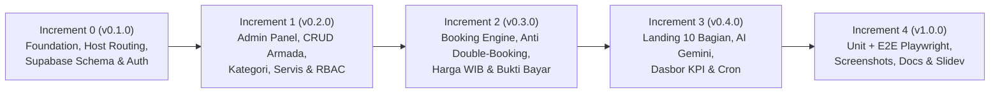
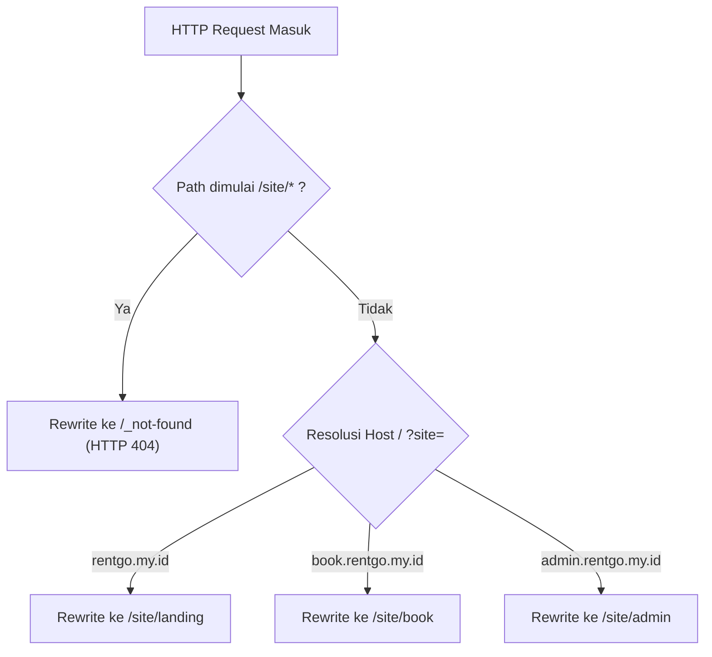

# RentGo Medan
## Sistem Manajemen Penyewaan Kendaraan Berbasis Web dengan Metodologi SDLC Incremental

  

    
Identitas Akademik UTS

    
<strong>Nama Mahasiswa:</strong> Akbar Riansyah

    
<strong>Proyek Individu:</strong> No. 2 - Penyewaan Kendaraan

    
<strong>Mata Kuliah:</strong> Metode Model Pengembangan Perangkat Lunak

    
<strong>Program Studi:</strong> TRPL Semester III - Politeknik Wilmar Bisnis Indonesia

  

  

    
Ekosistem Subdomain Tunggal

    
<code>rentgo.my.id</code> : Landing & Transparansi Tarif

    
<code>book.rentgo.my.id</code> : Katalog Real-Time, AI, & Checkout

    
<code>admin.rentgo.my.id</code> : Dasbor KPI, Armada, & Servis

  

---

# 1. Latar Belakang & Rumusan Masalah

Operasional usaha rental mobil dan motor di Kota Medan (Bandara Kualanamu, Stasiun Medan, dan rute wisata Danau Toba) sering menghadapi 4 kendala utama ketika masih dikelola via buku tulis atau spreadsheet terpisah:

  

    <h3 class="text-base">1. Risiko Double-Booking</h3>
    
Dua pelanggan memesan unit plat BK yang sama pada tanggal beririsan karena pencatatan jadwal tidak terkunci secara atomik.

  

  

    <h3 class="text-base">2. Ketidaksinkronan Jadwal Bengkel</h3>
    
Kendaraan yang sedang ganti oli atau servis rem tetap ditawarkan ke pelanggan karena data bengkel terpisah dari katalog.

  

  

    <h3 class="text-base">3. Ketidakpastian Perhitungan Tarif</h3>
    
Perhitungan durasi hari sewa inklusif dan verifikasi bukti transfer tidak memiliki riwayat status (state machine) yang baku.

  

  

    <h3 class="text-base">4. Kebingungan Memilih Armada</h3>
    
Wisatawan sering kesulitan menentukan unit yang tepat antara City Car, MPV 7 kursi, SUV tanjakan Berastagi, atau Hiace rombongan.

  

---

# 2. Alasan Pemilihan Metodologi SDLC Incremental

Mengapa **Incremental Model** dipilih dibandingkan Waterfall, Prototype, atau Scrum penuh untuk proyek individu ini?

| Kriteria Evaluasi | Waterfall | Prototype | Agile Scrum | **SDLC Incremental (Dipilih)** |
| :--- | :--- | :--- | :--- | :--- |
| **Pengiriman Perangkat Lunak Kerja** | Hanya di akhir proyek | Fokus UI semu | Tiap sprint (butuh tim) | **Bertahap tiap Increment (`v0.1.0`..`v1.0.0`)** |
| **Mitigasi Risiko Anti Double-Booking** | Terlambat diuji | Tidak menguji transaksi DB | Baik | **Diuji penuh sejak Increment 2 (`v0.3.0`)** |
| **Kesesuaian Proyek Individu UTS** | Terlalu kaku | Kurang kokoh di backend | Overhead seremonial tim | **Ideal untuk pengembang tunggal terstruktur** |

  <strong>Prinsip Utama:</strong> Setiap increment menghasilkan tambahan fungsionalitas yang terintegrasi penuh, melewati pemeriksaan tipe TypeScript, unit test Vitest, dan ditandai dengan Git tag rilis resmi.

---

# 3. Peta Jalan 5 Increment (`v0.1.0` s/d `v1.0.0`)

  
<strong>Inc 0</strong> Middleware 3 subdomain, 7 tabel SQL, cookie <code>__session</code>

  
<strong>Inc 1</strong> CRUD Kategori, Kendaraan (soft delete), Perawatan, Pelanggan

  
<strong>Inc 2</strong> Katalog WIB, checkout, state machine booking, WhatsApp

  
<strong>Inc 3</strong> Landing publik, AI "Bantu Saya Pilih", laporan CSV

  
<strong>Inc 4</strong> 21 Unit Test, 6 E2E Suite, 10 Screenshot, Dek Slidev

---

# 4. Arsitektur Satu Deployment - 3 Subdomain

Satu proyek **Next.js 15 App Router** melayani tiga permukaan melalui `src/middleware.ts`:

- **Keamanan Path Internal:** Permintaan langsung browser ke `/site/admin` otomatis dikembalikan **HTTP 404**.
- **Berbagi Sesi Lintas Subdomain:** Cookie HTTP-only `__session` menggunakan `domain: .rentgo.my.id` di produksi.
- **Efisiensi Biaya Rp0:** Hanya menggunakan 1 slot proyek pada Vercel Hobby Plan + Supabase Free + Firebase Spark.

---

# 5. Perancangan Basis Data (7 Tabel) & State Machine

  

    <h3 class="text-sm">7 Tabel Inti PostgreSQL (`0001_init.sql`)</h3>
    <ol class="mt-2 space-y-1 list-decimal pl-4">
      <li><code>users</code> : Profil pengguna Google & role (<code>customer</code> / <code>admin</code>)</li>
      <li><code>vehicle_categories</code> : 5 kategori armada</li>
      <li><code>vehicles</code> : 12 unit plat BK Medan + <code>deleted_at</code></li>
      <li><code>bookings</code> : Transaksi sewa + snapshot tarif harian</li>
      <li><code>payments</code> : Bukti bayar & status verifikasi (<code>unpaid</code>/<code>paid</code>/<code>refunded</code>)</li>
      <li><code>maintenance_logs</code> : Jadwal servis bengkel pengunci unit</li>
      <li><code>ai_recommendation_logs</code> : Audit & kuota harian AI (10x/hari)</li>
    </ol>
  

  

    <h3 class="text-sm">Aturan State Machine Booking</h3>
    <ul class="mt-2 space-y-1.5 list-disc pl-4">
      <li><code>pending -> confirmed</code> (Admin setelah cek bukti bayar)</li>
      <li><code>pending -> cancelled</code> (Customer mandiri / Admin)</li>
      <li><code>pending -> rejected</code> (Admin dengan alasan)</li>
      <li><code>pending -> expired</code> (Cron otomatis lewat 24 jam)</li>
      <li><code>confirmed -> ongoing</code> (Admin saat serah terima kunci)</li>
      <li><code>ongoing -> completed</code> (Admin saat unit kembali)</li>
    </ul>
  

---

# 6. Mesin Anti Double-Booking & Kalkulasi Harga Server-Side

  

    <h3 class="text-sm">1. Rumus Irisan Tanggal Inklusif (WIB)</h3>
    
Dua rentang tanggal <code>[existing.start, existing.end]</code> dan <code>[req.start, req.end]</code> dinyatakan bentrok apabila:

    <pre class="mt-2 p-2 rounded bg-slate-100 font-mono text-[11px]">existing.start_date &lt;= req.end_date
AND existing.end_date &gt;= req.start_date</pre>
    
Berlaku baik terhadap <code>bookings</code> aktif (<code>pending</code>, <code>confirmed</code>, <code>ongoing</code>) maupun <code>maintenance_logs</code> (<code>scheduled</code>, <code>in_progress</code>).

  

  

    <h3 class="text-sm">2. Kalkulasi Harga & Kunci Transaksional</h3>
    
Harga dari klien tidak pernah dipercaya; server menghitung ulang:

    <pre class="mt-2 p-2 rounded bg-slate-100 font-mono text-[11px]">total_days  = (end_date - start_date) + 1
total_price = total_days * vehicle.daily_price</pre>
    
Di PostgreSQL dikunci dengan <code>SELECT ... FOR UPDATE</code> pada fungsi RPC <code>create_booking_safe</code>; di repositori lokal dikunci dengan mutex asinkron <code>withStoreTransaction</code>.

  

---

# 7. Permukaan 1: Landing Page (`rentgo.my.id`)

  

    
  

  

    

      <h3 class="text-sm">10 Bagian Terstruktur</h3>
      <ul class="mt-1 space-y-1 list-disc pl-4">
        <li>Sticky Navbar & CTA Aplikasi Booking</li>
        <li>Split-Hero + Quick Date Search WIB</li>
        <li>Gambar LCP berprioritas tinggi (<code>fetchpriority="high"</code>)</li>
        <li>4 Keunggulan Operasional Nyata</li>
        <li>Armada Unggulan langsung dari Database</li>
        <li>Tabel Transparansi Tarif & FAQ Medan</li>
        <li>Structured Data JSON-LD <code>AutoRental</code></li>
      </ul>
    

  

---

# 8. Permukaan 2: Katalog Booking & Rekomendasi AI (`book.rentgo.my.id`)

  

    
  

  

    

      <h3 class="text-sm">Asisten AI "Bantu Saya Pilih"</h3>
      
Menggunakan <strong>Google Gemini SDK (<code>@google/genai</code>)</strong> dengan skema JSON terstruktur:

      <ul class="mt-1.5 space-y-1 list-disc pl-4">
        <li><strong>Bebas Halusinasi:</strong> AI hanya diberi kandidat kendaraan yang nyata dan tersedia pada tanggal pilihan pelanggan.</li>
        <li><strong>Validasi Server:</strong> Setiap <code>vehicle_id</code> diverifikasi ulang terhadap daftar unit tersedia.</li>
        <li><strong>Fallback Deterministik:</strong> Tetap bekerja 100% menggunakan algoritma skor aturan jika kuota API habis atau kunci belum diisi.</li>
      </ul>
    

  

---

# 9. Checkout Pelanggan, Bukti Bayar, & Konfirmasi WhatsApp

  

    
  

  

    
  

  Pelanggan memilih titik serah terima (<strong>Bandara Kualanamu</strong>, <strong>Stasiun Medan</strong>, atau <strong>Kantor RentGo Medan</strong>), mengunggah bukti transfer/QRIS, dapat membatalkan pesanan selama masih <code>pending</code>, dan mengirim pesan konfirmasi otomatis ke WhatsApp Admin.

---

# 10. Permukaan 3: Panel Operasional Admin (`admin.rentgo.my.id`)

  

    
  

  

    
  

  Dilengkapi proteksi RBAC ketat (<code>HTTP 403</code> bagi non-admin), 6 kartu KPI real-time, grafik pendapatan 6 bulan, matriks ketersediaan 7 hari, CRUD Kategori/Kendaraan/Perawatan, verifikasi pembayaran, dan ekspor laporan CSV.

---

# 11. Hasil Pengujian & Kesimpulan

  

    <h3 class="text-sm">1. Unit Test (Vitest)</h3>
    
21 / 21 Test PASS

    
Mencakup kalkulasi harga inklusif, state machine booking, validasi Zod, resolusi subdomain, simulasi balapan konkuren, dan fallback AI.

  

  

    <h3 class="text-sm">2. Black-Box Testing</h3>
    
20 / 20 Skenario PASS

    
Seluruh kebutuhan fungsional <code>FR-01</code> s/d <code>FR-19</code> terverifikasi pada tabel uji <code>TC-001</code> s/d <code>TC-020</code>.

  

  

    <h3 class="text-sm">3. E2E Playwright</h3>
    
6 / 6 Suite E2E PASS

    
Menguji alur nyata di Chromium headless: RBAC 403/404, CRUD Admin, siklus penuh booking, pembatalan, kunci servis, dan rekomendasi AI.

  

  <strong>Kesimpulan:</strong> Penerapan <strong>SDLC Incremental</strong> memungkinkan pembangunan sistem penyewaan kendaraan <strong>RentGo Medan</strong> secara bertahap dari fondasi multi-subdomain (`v0.1.0`) hingga rilis produksi (`v1.0.0`) yang bebas double-booking, teruji secara otomatis, dan beroperasi penuh dengan biaya infrastruktur Rp0.

