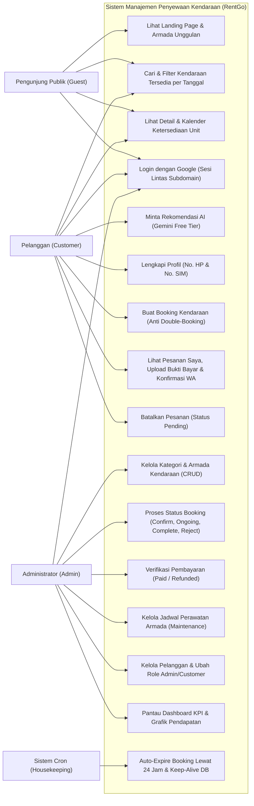

# 01 - Analisis Kebutuhan Perangkat Lunak (RentGo)

**Mata Kuliah:** Metode Model Pengembangan Perangkat Lunak (TRPL Semester III)  
**Institusi:** Politeknik Wilmar Bisnis Indonesia  
**Mahasiswa:** Akbar Riansyah  
**Topik Proyek:** Proyek Individu No. 2 - Sistem Manajemen Penyewaan Kendaraan (**RentGo**)

---

## 1. Latar Belakang & Rumusan Masalah

Usaha penyewaan kendaraan (mobil dan sepeda motor) di wilayah Medan dan sekitarnya melayani kebutuhan transportasi wisatawan (rute Medan, Bandara Kualanamu, Berastagi, hingga Danau Toba) maupun perjalanan dinas. Pada operasional konvensional, pencatatan pesanan masih dilakukan melalui pesan WhatsApp dan buku agenda manual, yang menimbulkan empat masalah utama:

1. **Jadwal Bentrok (*Double Booking*):** Kendaraan yang sama sering tercatat disewa oleh dua pelanggan berbeda pada rentang tanggal yang beririsan karena keterlambatan pembaruan status armada.
2. **Ketidakpastian Ketersediaan Armada:** Calon penyewa harus menunggu balasan admin hanya untuk mengetahui unit mana yang bebas pada tanggal tertentu dan tidak sedang dalam perawatan bengkel (*maintenance*).
3. **Kesalahan Perhitungan Biaya & Riwayat Pembayaran:** Perhitungan durasi sewa harian dan verifikasi bukti transfer tidak terpusat, sehingga menyulitkan rekonsiliasi pendapatan bulanan.
4. **Kebingungan Memilih Unit yang Tepat:** Pelanggan dari luar kota sering kesulitan menentukan jenis kendaraan yang sesuai dengan jumlah penumpang, medan perjalanan (misal tanjakan Berastagi), dan anggaran harian.

**Tujuan Produk:** Membangun platform web terpadu **RentGo** yang memisahkan tiga permukaan penggunaan (Landing publik di `rentgo.my.id`, Booking pelanggan di `book.rentgo.my.id`, dan Dashboard operasional admin di `admin.rentgo.my.id`) dalam satu basis kode dan satu database relasional dengan pencegahan *double-booking* di tingkat database serta asisten rekomendasi AI berbasis ketersediaan nyata.

---

## 2. Identifikasi Aktor

| Aktor | Surface Utama | Deskripsi & Hak Akses |
|---|---|---|
| **Pengunjung Publik (*Guest*)** | `rentgo.my.id` & `book.rentgo.my.id` | Melihat informasi layanan di halaman Landing, menjelajahi katalog armada, memeriksa ketersediaan per tanggal, serta melihat detail spesifikasi kendaraan tanpa perlu login. |
| **Pelanggan (*Customer*)** | `book.rentgo.my.id` | Pengguna yang masuk menggunakan akun Google (Firebase Auth) dengan peran `customer`. Dapat menggunakan fitur rekomendasi AI, melengkapi profil (No. HP & No. SIM), membuat booking, mengunggah bukti pembayaran, membatalkan pesanan yang masih `pending`, dan mengirim konfirmasi WhatsApp. |
| **Administrator (*Admin*)** | `admin.rentgo.my.id` | Pengelola operasional rental dengan peran `admin`. Mengelola kategori dan armada kendaraan (CRUD + soft delete + upload foto), memverifikasi pembayaran, memproses perubahan status pesanan sesuai *state machine*, mencatat jadwal perawatan bengkel, mengelola peran pelanggan, serta memantau KPI dan grafik pendapatan. |
| **Sistem Penjadwal (*Cron*)** | `/api/cron/housekeeping` | Proses otomatis terjadwal harian (Vercel Cron) yang menjaga koneksi database tetap aktif (*keep-alive*) dan mengubah status pesanan `pending` yang melewati batas waktu 24 jam (`expires_at`) menjadi `expired`. |

---

## 3. Diagram Use Case (Mermaid)

---

## 4. User Stories Utama

| ID | Sebagai | Saya Ingin | Sehingga | Kriteria Penerimaan Ringkas |
|---|---|---|---|---|
| **US-01** | Pengunjung | Memilih tanggal ambil dan tanggal kembali di halaman utama atau katalog | Saya hanya melihat kendaraan yang benar-benar bebas pada tanggal tersebut | Unit yang memiliki booking aktif (`pending`, `confirmed`, `ongoing`) atau perawatan (`scheduled`, `in_progress`) pada rentang tersebut tidak ditampilkan. |
| **US-02** | Pelanggan | Masuk satu kali dengan akun Google saya | Saya langsung dikenali di `rentgo.my.id`, `book.rentgo.my.id`, maupun `admin.rentgo.my.id` | Cookie `__session` disetel `HttpOnly`, `SameSite=Lax`, dengan domain `.rentgo.my.id` di produksi. |
| **US-03** | Pelanggan | Meminta saran kendaraan berdasarkan jumlah penumpang, anggaran, dan tujuan perjalanan | Saya mendapatkan maksimal 3 pilihan unit yang cocok dan pasti tersedia | Sistem memfilter kandidat dari `get_available_vehicles` sebelum memanggil Gemini API, dan menggunakan skoring heuristik jika kuota AI habis. |
| **US-04** | Pelanggan | Memesan kendaraan dengan harga yang transparan | Total biaya dihitung akurat berdasarkan jumlah hari inklusif dan harga terkunci saat pemesanan | `total_days = (end_date - start_date) + 1`, harga dihitung di server dan disimpan ke `daily_price_snapshot`. |
| **US-05** | Pelanggan | Mengunggah bukti transfer dan menekan tombol konfirmasi WhatsApp | Admin dapat segera memverifikasi pembayaran pesanan saya | File bukti bayar (`jpg/png/webp/pdf` <= 2MB) tersimpan dan tombol WA membuka pesan berisi `booking_code`. |
| **US-06** | Admin | Menambah, mengubah, dan menonaktifkan (soft delete) data kendaraan beserta fotonya | Katalog armada selalu mencerminkan kondisi unit terbaru tanpa merusak riwayat transaksi lama | Kendaraan dengan booking aktif tidak dapat dihapus; penghapusan mengisi kolom `deleted_at`. |
| **US-07** | Admin | Mencatat jadwal servis/perawatan bengkel untuk unit tertentu | Kendaraan tersebut otomatis terkunci dari pencarian pelanggan selama tanggal perawatan | Unit dengan `maintenance_logs` berstatus `scheduled` atau `in_progress` otomatis dikecualikan oleh `get_available_vehicles` dan `create_booking`. |
| **US-08** | Admin | Memperbarui status pesanan mengikuti alur resmi (`pending -> confirmed -> ongoing -> completed`) | Siklus serah terima dan pengembalian kendaraan tercatat tertib | Transisi status di luar aturan *state machine* ditolak oleh server dengan pesan kesalahan yang jelas. |

---

## 5. Kebutuhan Fungsional (Functional Requirements - FR)

- **FR-01 (Multi-Host Routing):** Satu aplikasi Next.js melayani tiga surface berdasarkan header `Host` (`rentgo.my.id`, `book.rentgo.my.id`, `admin.rentgo.my.id`) dan menolak akses langsung ke path internal `/site/*` (HTTP 404).
- **FR-02 (Autentikasi & RBAC):** Login Google menggunakan Firebase Auth, diverifikasi di server menggunakan `firebase-admin` untuk menerbitkan session cookie 5 hari. Role `admin` ditentukan dari allowlist `ADMIN_EMAILS` atau promosi melalui manajemen pelanggan.
- **FR-03 (Manajemen Armada & Kategori):** Admin dapat melakukan CRUD penuh pada `vehicle_categories` dan `vehicles` (pencarian, filter kategori/status/transmisi, paginasi, unggah foto, dan soft delete).
- **FR-04 (Pencarian Ketersediaan):** Sistem menampilkan kendaraan berstatus `active` (`deleted_at IS NULL`) yang tidak memiliki irisan tanggal dengan booking aktif maupun jadwal perawatan.
- **FR-05 (Transaksi Booking & Anti Double-Booking):** Pembuatan booking memvalidasi kelengkapan No. HP & No. SIM, menghitung total harga di server, menetapkan `expires_at` (+24 jam), membuat baris `payments` (`unpaid`), dan menolak bentrok jadwal melalui constraint GIST `no_double_booking`.
- **FR-06 (State Machine Booking & Pembayaran):** Mendukung transisi status tervalidasi (`pending`, `confirmed`, `ongoing`, `completed`, `cancelled`, `rejected`, `expired`) serta verifikasi pembayaran (`unpaid`, `paid`, `refunded`).
- **FR-07 (Rekomendasi AI Gemini):** Endpoint `POST /api/ai/recommend` menerapkan batas 10 permintaan/user/hari, hanya mengirim kandidat kendaraan yang tersedia ke Gemini API (`structured output`), membuang ID tidak valid, menyediakan fallback heuristik, dan mencatat log ke `ai_recommendation_logs`.
- **FR-08 (Dashboard & Statistik):** Menampilkan KPI operasional, grafik pendapatan 6 bulan terakhir dari pembayaran `paid`, unit terlaris, dan daftar pesanan terbaru.
- **FR-09 (Housekeeping Cron):** Endpoint `GET /api/cron/housekeeping` (dilindungi `CRON_SECRET`) menjalankan query keep-alive dan mengubah booking `pending` yang melewati `expires_at` menjadi `expired`.

---

## 6. Kebutuhan Non-Fungsional (Non-Functional Requirements - NFR)

- **NFR-01 (Keamanan Data):** Row Level Security (RLS) diaktifkan pada seluruh tabel Supabase tanpa policy publik (*deny-all*); seluruh akses database berjalan di sisi server menggunakan service role key.
- **NFR-02 (Integritas Konkurensi):** Dua permintaan booking simultan untuk kendaraan dan tanggal yang sama dijamin hanya meloloskan tepat satu transaksi.
- **NFR-03 (Kinerja & SEO):** Halaman Landing menggunakan *Server Components / ISR* dengan target skor Lighthouse Performance & Accessibility >= 90.
- **NFR-04 (Aksesibilitas & Responsivitas):** Antarmuka memenuhi rasio kontras minimum WCAG AA (4.5:1 untuk teks normal), dapat dinavigasi dengan papan ketik (`Tab`, `Enter`, `Escape`), memiliki ukuran sentuh minimal 44x44px, dan diuji pada lebar layar 360px, 768px, serta 1280px.
- **NFR-05 (Efisiensi Biaya):** Seluruh komponen infrastruktur berjalan pada kuota gratis (Rp0) di luar biaya kepemilikan domain `.my.id`.

---

## 7. Batasan Sistem (Constraints)

1. Wilayah operasional awal difokuskan pada layanan rental di Kota Medan dan sekitarnya (titik jemput/kembali: Bandara Kualanamu, Stasiun Medan, dan Kantor RentGo Medan).
2. Mata uang transaksi menggunakan Rupiah (`IDR`) tanpa desimal (`numeric(12,0)`), dan seluruh perhitungan tanggal mengacu pada zona waktu **Asia/Jakarta (WIB)**.
3. Demi privasi dan keamanan data pribadi pada lingkup MVP, sistem hanya menyimpan nama, email, foto profil Google, nomor HP, dan nomor SIM tanpa menyimpan foto KTP asli.
