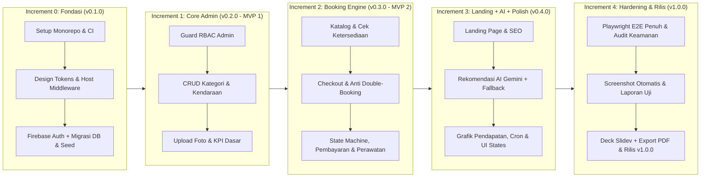

# 02 - Model Pengembangan Perangkat Lunak: Incremental Model

Dokumen ini menjelaskan pemilihan dan penerapan **Incremental Model** sebagai metodologi pengembangan perangkat lunak (*Software Development Life Cycle* / SDLC) untuk proyek **RentGo**.

---

## 1. Justifikasi Pemilihan Model Incremental

Pengembangan **RentGo** menggunakan **Incremental Model**, di mana kebutuhan sistem dibagi menjadi lima bagian terencana (*Increment 0* hingga *Increment 4*). Setiap increment menjalani tahapan rekayasa lengkap secara berurutan (analisis -> desain -> implementasi -> pengujian -> deployment -> review) dan menghasilkan perangkat lunak yang berfungsi (*working software*).

### Mengapa Incremental Model Paling Tepat untuk RentGo?

1. **Kebutuhan Sistem Sudah Jelas di Awal:** Spesifikasi arsitektur, skema database, tiga surface domain, dan aturan bisnis penyewaan kendaraan telah terdefinisi dengan tegas sejak awal, sehingga tidak memerlukan eksperimen berulang untuk mencari bentuk produk seperti pada *Prototyping Model*.
2. **Menghindari Risiko Kegagalan di Akhir (*Big-Bang Integration Risk*):** Berbeda dengan *Waterfall* murni yang baru menghasilkan aplikasi yang bisa dijalankan di tahap paling akhir, pendekatan *Incremental* memastikan pada akhir **Increment 1** sistem sudah memiliki MVP-1 (Admin dapat mengelola armada), dan pada akhir **Increment 2** sistem sudah menjadi MVP-2 yang dapat dipakai menyewa kendaraan secara utuh.
3. **Kesesuaian dengan Proyek Individu:** Metodologi *Agile/Scrum* penuh dirancang untuk tim lintas fungsi dengan *Sprint Planning*, *Daily Standup*, dan *Product Owner* terpisah. Karena proyek ini dikerjakan secara individu oleh satu mahasiswa dengan tenggat waktu UTS yang pasti, *Incremental Model* memberikan struktur tahapan yang disiplin sekaligus mengadopsi praktik terbaik *Agile* berupa prioritas **MoSCoW**, **Definition of Done (DoD)** per increment, dan pengujian terotomatisasi.

---

## 2. Perbandingan Model SDLC

| Aspek Pembanding | Waterfall | Prototyping | Agile / Scrum | **Incremental (Dipilih)** |
|---|---|---|---|---|
| **Kejelasan Kebutuhan Awal** | Harus 100% kaku di awal | Kebutuhan masih kabur / eksploratif | Berubah dinamis tiap sprint | **Jelas di awal, dibangun bertahap** |
| **Kapan Produk Bisa Dipakai?** | Di akhir proyek (*Big-Bang*) | Cepat terlihat, tetapi kode prototipe sering dibuang | Setiap akhir sprint (1-4 minggu) | **Setiap akhir increment (kumulatif & produksi)** |
| **Kesesuaian Ukuran Tim** | Tim menengah - besar | 1 - 3 orang | Tim 3 - 9 orang + Product Owner | **Sangat cocok untuk pengembang individu** |
| **Manajemen Risiko Teknis** | Risiko integrasi menumpuk di akhir | Risiko arsitektur rapuh jika prototipe dipaksa jadi produk | Risiko *scope creep* bila tanpa PO tegas | **Risiko tertinggi (routing, auth, DB constraint) diselesaikan di Increment 0-2** |
| **Kontrol Kualitas & Dokumentasi** | Dokumentasi berat di awal | Dokumentasi minim | Dokumentasi ringan | **Seimbang: dokumen analisis & desain di awal, laporan uji diperbarui tiap increment** |

---

## 3. Diagram Alur 5 Increment RentGo

---

## 4. Prioritas Fitur (Metode MoSCoW)

- **Must Have (Wajib Ada di MVP):**
  - Login Google (Firebase Auth) dengan sesi lintas subdomain dan RBAC (`customer` | `admin`).
  - CRUD Kategori dan Kendaraan (pencarian, filter, paginasi, soft delete).
  - Pengecekan ketersediaan kendaraan per rentang tanggal.
  - Pemesanan (*booking*) bebas bentrok jadwal (*anti double-booking* di level database) dengan kalkulasi harga di server.
  - Alur *state machine* status booking dan verifikasi pembayaran manual oleh admin.
  - Halaman "Pesanan Saya" untuk pelanggan (lihat detail, batalkan jika `pending`).
  - Dashboard KPI dasar admin dan Landing page publik.
  - Konfigurasi deployment 1 aplikasi untuk 3 domain.
- **Should Have (Penting & Dikerjakan di Increment 2-3):**
  - Rekomendasi kendaraan tersedia menggunakan AI Gemini (`@google/genai`) dengan fallback heuristik.
  - Unggah foto kendaraan dan unggah bukti transfer pembayaran.
  - Modul jadwal perawatan (*maintenance*) yang otomatis memblokir ketersediaan unit.
  - Grafik pendapatan 6 bulan & daftar unit terlaris di dashboard admin.
  - *Housekeeping cron* untuk auto-expire pesanan `pending` lewat 24 jam dan *keep-alive* database.
  - Tombol konfirmasi WhatsApp dengan pesan terformat otomatis.
- **Could Have (Nilai Tambah yang Disertakan):**
  - Kalender timeline ketersediaan armada di dashboard admin.
  - Ekspor data pesanan ke CSV.
  - Structured data JSON-LD (`AutoRental`) untuk SEO lokal Medan.
- **Won't Have (Ditunda ke Pasca-MVP / `docs/BACKLOG.md`):**
  - Integrasi payment gateway otomatis, notifikasi email/SMS otomatis, multi-cabang/multi-mitra, sistem kupon, dan aplikasi mobile native.

---

## 5. Rincian Rencana Increment & Definition of Done (DoD)

Setiap increment dinyatakan **Selesai (Done)** hanya jika memenuhi seluruh syarat berikut:
1. Kode diimplementasikan pada branch khusus (`inc-0-foundation` s/d `inc-4-hardening-release`) dan di-merge ke `main` dengan tag versi semantik (`v0.1.0` s/d `v1.0.0`).
2. Pemeriksaan tipe statis (`tsc --noEmit`) dan linter (`eslint`) lulus tanpa error.
3. Seluruh pengujian unit (`vitest`) dan pengujian E2E (`playwright`) untuk fitur pada increment tersebut berstatus **Lulus (PASS)**.
4. Dokumen kemajuan `docs/progress.md` dan `CHANGELOG.md` diperbarui dengan hasil nyata.

| Increment | Branch & Tag | Fokus Capaian | Deliverable Utama |
|---|---|---|---|
| **Increment 0** | `inc-0-foundation` (`v0.1.0`) | Fondasi Arsitektur & Database | Monorepo `website/` + `slidev/`, `tokens.css`, middleware 3 host, Firebase Auth session cookie, `0001_init.sql` + `seed.sql`, `lib/env.ts`, halaman `_styleguide`. |
| **Increment 1** | `inc-1-core-admin` (`v0.2.0`) | *MVP-1:* Core Admin Armada | Dashboard KPI dasar, guard RBAC admin, CRUD Kategori, CRUD Kendaraan + soft delete + upload foto. |
| **Increment 2** | `inc-2-booking-engine` (`v0.3.0`) | *MVP-2:* Mesin Booking & Operasional | Katalog & filter tanggal di `book.`, detail unit, checkout, Pesanan Saya, pembatalan, upload bukti bayar, WA konfirmasi, admin booking state machine, pembayaran, perawatan, dan pelanggan. |
| **Increment 3** | `inc-3-landing-ai` (`v0.4.0`) | Landing Page, AI Gemini & Polish | Landing page penuh + SEO, rekomendasi AI Gemini (`POST /api/ai/recommend`) + fallback heuristik, grafik pendapatan Recharts, endpoint cron housekeeping, state `loading/empty/error` + toast. |
| **Increment 4** | `inc-4-hardening-release` (`v1.0.0`) | Hardening, Dokumentasi Uji & Slidev | Suite E2E lengkap, audit keamanan Bagian 10, tangkapan layar otomatis `docs/screenshots/`, laporan uji `04-pengujian.md`, panduan deploy `05-deployment.md`, skrip demo `06-presentasi.md`, dan deck `slidev/` + PDF. |
