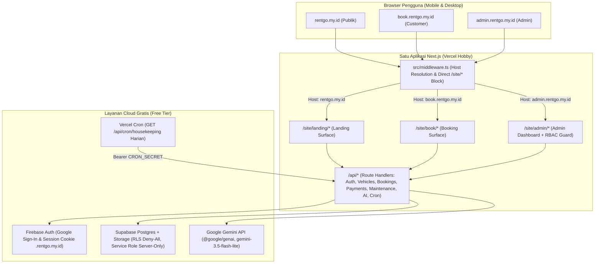
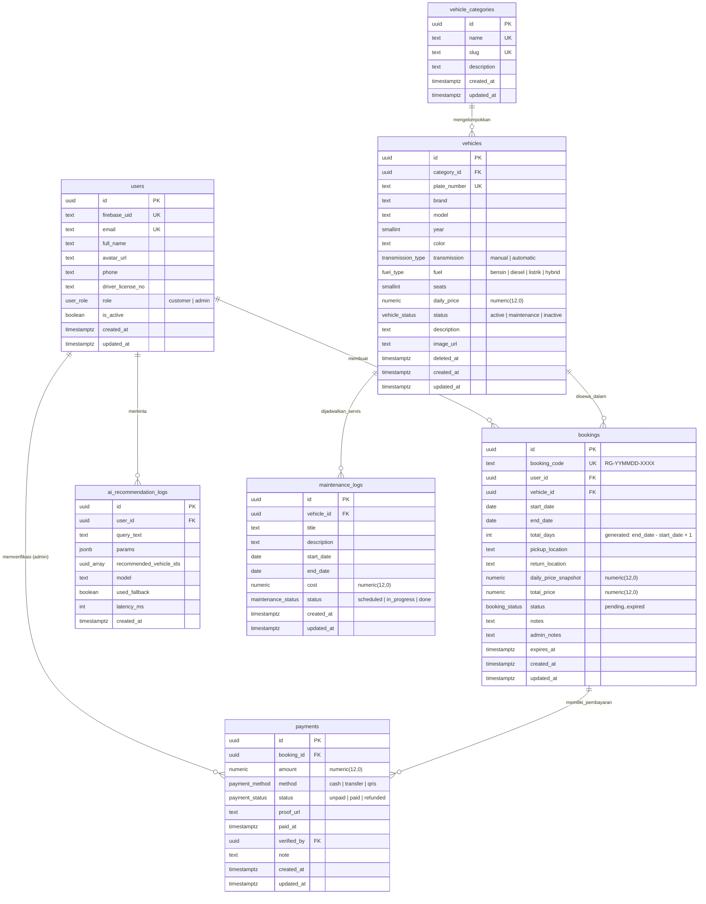
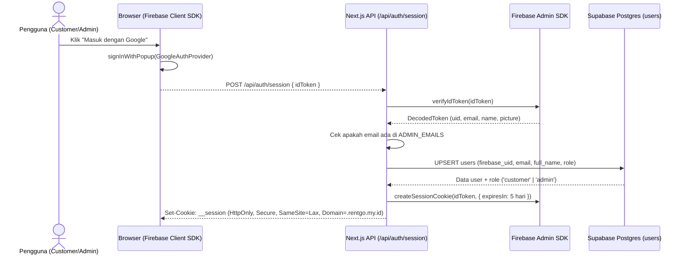
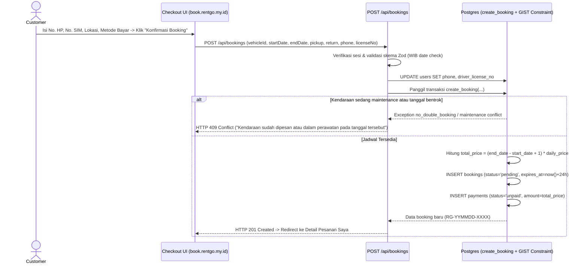
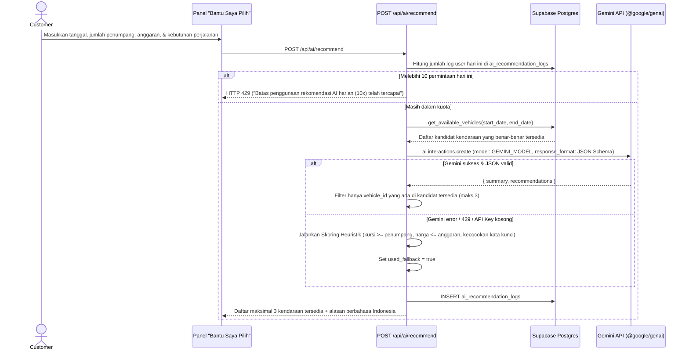

# 03 - Perancangan Sistem, Arsitektur, & Database (RentGo)

Dokumen ini memuat rancangan arsitektur perangkat lunak, skema basis data relasional (ERD & Kamus Data), diagram urutan (*sequence diagrams*), serta rancangan struktur antarmuka untuk tiga surface **RentGo**.

---

## 1. Arsitektur Sistem (Satu Aplikasi untuk Tiga Subdomain)

RentGo menerapkan arsitektur **Single Codebase Multi-Surface** di atas Next.js App Router. Ketiga domain menunjuk ke satu deployment yang sama di Vercel; `src/middleware.ts` memeriksa header `Host` pada setiap request dan melakukan *internal rewrite* ke folder rute yang sesuai tanpa mengubah URL di bilah alamat browser.



### Aturan Resolusi Host & Keamanan Rute
1. Akses langsung dari browser ke URL `/site/landing`, `/site/book`, atau `/site/admin` langsung dikembalikan **HTTP 404** oleh middleware.
2. Di lingkungan non-produksi (`development` / `test` / preview `.vercel.app`), parameter `?site=landing|book|admin` dapat digunakan untuk berpindah surface dan disimpan ke cookie `__site`. Fitur ini dinonaktifkan ketika `NODE_ENV === 'production'` pada domain utama.

---

## 2. Entity Relationship Diagram (ERD)



### Mekanisme Anti Double-Booking di Level Database
Untuk menjamin tidak ada dua pesanan aktif pada kendaraan dan tanggal yang beririsan meskipun terjadi *race condition* (dua request masuk pada milidetik yang sama), tabel `bookings` menggunakan PostgreSQL Exclusion Constraint berbasis indeks `btree_gist`:

```sql
constraint no_double_booking exclude using gist (
  vehicle_id with =,
  daterange(start_date, end_date, '[]') with &&
) where (status in ('pending','confirmed','ongoing'))
```

Batas `'[]'` menandakan rentang tanggal **inklusif** di kedua ujung. Begitu pesanan berstatus `cancelled`, `rejected`, `expired`, atau `completed`, tanggal tersebut otomatis terbuka kembali.

---

## 3. Kamus Data (Data Dictionary)

### 3.1 Tabel `users`
| Kolom | Tipe Data | Constraint | Keterangan |
|---|---|---|---|
| `id` | `uuid` | `PK, default gen_random_uuid()` | Identifier internal pengguna |
| `firebase_uid` | `text` | `NOT NULL, UNIQUE` | UID dari Firebase Authentication |
| `email` | `text` | `NOT NULL, UNIQUE` | Alamat email akun Google |
| `full_name` | `text` | `NOT NULL` | Nama lengkap pengguna |
| `avatar_url` | `text` | `NULL` | URL foto profil Google |
| `phone` | `text` | `NULL` | Nomor HP/WhatsApp aktif (wajib saat checkout) |
| `driver_license_no` | `text` | `NULL` | Nomor SIM A/C (wajib saat checkout) |
| `role` | `user_role` | `NOT NULL, default 'customer'` | Peran akses (`customer` atau `admin`) |
| `is_active` | `boolean` | `NOT NULL, default true` | Status aktif akun |
| `created_at` / `updated_at` | `timestamptz` | `NOT NULL, default now()` | Waktu pembuatan & pembaruan baris |

### 3.2 Tabel `vehicle_categories`
| Kolom | Tipe Data | Constraint | Keterangan |
|---|---|---|---|
| `id` | `uuid` | `PK, default gen_random_uuid()` | Identifier kategori |
| `name` | `text` | `NOT NULL, UNIQUE` | Nama kategori (misal: MPV/Minibus, SUV, Motor) |
| `slug` | `text` | `NOT NULL, UNIQUE` | Slug URL ramah SEO |
| `description` | `text` | `NULL` | Penjelasan singkat kategori |

### 3.3 Tabel `vehicles`
| Kolom | Tipe Data | Constraint | Keterangan |
|---|---|---|---|
| `id` | `uuid` | `PK, default gen_random_uuid()` | Identifier kendaraan |
| `category_id` | `uuid` | `FK -> vehicle_categories(id) RESTRICT` | Kategori kendaraan |
| `plate_number` | `text` | `NOT NULL, UNIQUE` | Nomor polisi (contoh: `BK 1284 AAB`) |
| `brand` / `model` | `text` | `NOT NULL` | Merek (Toyota, Honda) & model (Avanza, PCX 160) |
| `year` | `smallint` | `CHECK (year BETWEEN 1990 AND 2100)` | Tahun perakitan kendaraan |
| `color` | `text` | `NULL` | Warna bodi kendaraan |
| `transmission` | `transmission_type` | `NOT NULL` | `manual` atau `automatic` |
| `fuel` | `fuel_type` | `NOT NULL` | `bensin`, `diesel`, `listrik`, atau `hybrid` |
| `seats` | `smallint` | `CHECK (seats BETWEEN 1 AND 60)` | Kapasitas tempat duduk |
| `daily_price` | `numeric(12,0)` | `CHECK (daily_price > 0)` | Tarif sewa per hari dalam Rupiah |
| `status` | `vehicle_status` | `NOT NULL, default 'active'` | `active`, `maintenance`, atau `inactive` |
| `description` | `text` | `NULL` | Spesifikasi tambahan & fasilitas unit |
| `image_url` | `text` | `NULL` | Path ilustrasi SVG atau URL foto di Storage |
| `deleted_at` | `timestamptz` | `NULL` | Penanda *soft delete* (`NULL` = masih aktif) |

### 3.4 Tabel `bookings`
| Kolom | Tipe Data | Constraint | Keterangan |
|---|---|---|---|
| `id` | `uuid` | `PK, default gen_random_uuid()` | Identifier pesanan |
| `booking_code` | `text` | `NOT NULL, UNIQUE` | Kode unik format `RG-YYMMDD-XXXX` |
| `user_id` | `uuid` | `FK -> users(id) RESTRICT` | Pemesan (customer) |
| `vehicle_id` | `uuid` | `FK -> vehicles(id) RESTRICT` | Unit kendaraan yang disewa |
| `start_date` / `end_date` | `date` | `NOT NULL, CHECK (end_date >= start_date)` | Tanggal ambil & kembali (inklusif WIB) |
| `total_days` | `int` | `GENERATED ALWAYS AS (end_date - start_date + 1) STORED` | Durasi hari sewa inklusif |
| `pickup_location` / `return_location` | `text` | `NOT NULL` | Lokasi serah terima & pengembalian di Medan |
| `daily_price_snapshot` | `numeric(12,0)` | `NOT NULL` | Harga per hari saat transaksi dibuat |
| `total_price` | `numeric(12,0)` | `NOT NULL` | Total biaya sewa (`total_days * daily_price_snapshot`) |
| `status` | `booking_status` | `NOT NULL, default 'pending'` | Status siklus hidup pesanan |
| `notes` / `admin_notes` | `text` | `NULL` | Catatan pelanggan & catatan internal admin |
| `expires_at` | `timestamptz` | `NULL` | Tenggat pembayaran untuk pesanan `pending` (+24 jam) |

### 3.5 Tabel `payments`, `maintenance_logs`, dan `ai_recommendation_logs`
- **`payments`:** Menyimpan nilai tagihan (`amount`), metode (`cash`, `transfer`, `qris`), status (`unpaid`, `paid`, `refunded`), bukti transfer (`proof_url`), waktu lunas (`paid_at`), serta admin pemverifikasi (`verified_by`).
- **`maintenance_logs`:** Menyimpan jadwal perawatan kendaraan (`vehicle_id`, `title`, `start_date`, `end_date`, `cost`, `status`: `scheduled` | `in_progress` | `done`).
- **`ai_recommendation_logs`:** Mencatat audit pemanggilan rekomendasi AI (`user_id`, `query_text`, `params`, `recommended_vehicle_ids`, `model`, `used_fallback`, `latency_ms`, `created_at`) sekaligus menjadi dasar perhitungan *rate limit* 10 permintaan/user/hari.

---

## 4. Sequence Diagram Alur Utama

### 4.1 Alur Login Lintas Subdomain (`POST /api/auth/session`)



### 4.2 Alur Pembuatan Booking Anti-Bentrok (`POST /api/bookings`)



### 4.3 Alur Rekomendasi AI dengan Penjaga Stok & Fallback (`POST /api/ai/recommend`)



---

## 5. Rancangan Struktur Antarmuka (Wireframe Ringkas)

1. **Surface Landing (`rentgo.my.id`):**
   - **Header Sticky:** Logo SVG RentGo, tautan jangkar (`#armada`, `#cara-sewa`, `#harga`, `#faq`), indikator pengguna / tombol Masuk Google, dan tombol aksen "Mulai Booking".
   - **Hero Split Layout:** Judul utama bernuansa rambu perjalanan Medan, kartu formulir pencarian cepat (Tanggal Ambil, Tanggal Kembali, Kategori -> langsung membuka `book.rentgo.my.id` dengan parameter pencarian).
   - **Armada Unggulan & Transparansi Tarif:** Grid unit nyata dari database lengkap dengan label transmisi, kapasitas kursi, bahan bakar, dan harga harian (`Rp xxx.xxx / hari`).
   - **Alur Penyewaan & FAQ Spesifik Medan:** Penjelasan syarat SIM, titik serah terima Kualanamu/Stasiun Medan, dan kebijakan pembatalan.
2. **Surface Booking (`book.rentgo.my.id`):**
   - **Bilah Pencarian & Filter Ketersediaan:** Pemilih rentang tanggal WIB, filter kategori, transmisi, kapasitas kursi minimum, rentang harga maksimum, dan pengurutan.
   - **Panel Asisten AI ("Bantu Saya Pilih"):** Formulir interaktif kebutuhan perjalanan yang menampilkan hingga 3 rekomendasi stok tersedia beserta alasan pemilihan.
   - **Halaman Detail & Checkout:** Kalender tanggal terblokir, rincian kalkulasi harga (`hari x tarif`), form kelengkapan SIM/HP, pilihan lokasi jemput/kembali, dan halaman "Pesanan Saya" (unggah bukti bayar + tombol WhatsApp).
3. **Surface Admin (`admin.rentgo.my.id`):**
   - **Sidebar Navy (`#0B1F3A`):** Navigasi ke Ringkasan Dashboard, Armada Kendaraan, Kategori, Pesanan (Booking), Pembayaran, Jadwal Perawatan, Pelanggan, dan Kalender Ketersediaan.
   - **Workspace Operasional:** Kartu KPI nyata dari database, grafik batang pendapatan 6 bulan, tabel berfilter dengan tombol aksi kontekstual sesuai *state machine* booking.
