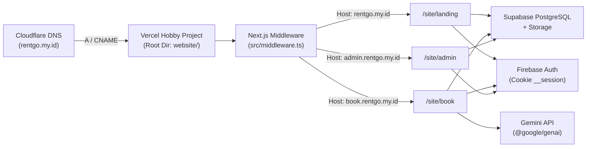

# Bab 5: Panduan Deployment & Konfigurasi Produksi - RentGo Medan

Dokumen ini menjelaskan langkah-langkah deployment produksi aplikasi **RentGo** menggunakan infrastruktur **100% Free Tier (Rp0)**:
1. **Vercel Hobby Plan** (Single Project Deployment dari direktori `website/`)
2. **Cloudflare DNS** (Pengaturan domain `rentgo.my.id`, `book.rentgo.my.id`, dan `admin.rentgo.my.id`)
3. **Supabase Free Tier** (Database PostgreSQL 500 MB + Storage 1 GB)
4. **Firebase Authentication Spark Plan** (Google Sign-In + Service Account Admin SDK)
5. **Google AI Studio Free Tier** (Kunci API Gemini untuk fitur Rekomendasi AI)

---

## 5.1 Arsitektur Deployment Satu Proyek (Single Deployment Architecture)



Keunggulan pendekatan satu proyek Vercel ini:
- Menghemat kuota proyek pada Vercel Hobby Plan.
- Berbagi sesi autentikasi lintas subdomain melalui satu cookie HTTP-only `__session` dengan `domain: .rentgo.my.id`.
- Satu pipeline CI/CD untuk seluruh permukaan aplikasi.

---

## 5.2 Langkah 1: Persiapan Database & Storage di Supabase

1. Masuk ke [Supabase Dashboard](https://supabase.com/dashboard) dan buat proyek baru bernama `rentgo-medan` (Region: **Singapore `ap-southeast-1`**).
2. Buka menu **SQL Editor**, lalu jalankan isi berkas:
   - `website/supabase/migrations/0001_init.sql` (membuat 7 tabel, indeks, fungsi RPC `create_booking_safe`, dan Row Level Security).
   - `website/supabase/seed.sql` (mengisi 5 kategori, 12 unit kendaraan plat BK Medan, 5 akun pengguna, 8 transaksi booking, dan 3 jadwal perawatan).
3. Buka menu **Storage**, lalu buat 2 bucket publik:
   - `vehicles` (publik, batas ukuran 2 MB, tipe MIME `image/jpeg`, `image/png`, `image/webp`)
   - `payment-proofs` (publik dengan nama objek UUID acak, batas ukuran 2 MB)
4. Salin kredensial dari **Project Settings -> API**:
   - `NEXT_PUBLIC_SUPABASE_URL`
   - `NEXT_PUBLIC_SUPABASE_ANON_KEY`
   - `SUPABASE_SERVICE_ROLE_KEY`

---

## 5.3 Langkah 2: Konfigurasi Firebase Google Sign-In

1. Buka [Firebase Console](https://console.firebase.google.com/) dan pilih atau buat proyek `rentgo-medan`.
2. Masuk ke **Authentication -> Sign-in method**, lalu aktifkan penyedia **Google**.
3. Masuk ke **Authentication -> Settings -> Authorized domains**, lalu tambahkan:
   - `localhost`
   - `rentgo.my.id`
   - `book.rentgo.my.id`
   - `admin.rentgo.my.id`
4. Masuk ke **Project Settings -> Service accounts**, klik **Generate new private key**, lalu ubah berkas JSON tersebut menjadi string Base64 satu baris:
   ```powershell
   [Convert]::ToBase64String([IO.File]::ReadAllBytes("service-account.json"))
   ```
   Simpan hasilnya ke variabel `FIREBASE_SERVICE_ACCOUNT_JSON_BASE64`.

---

## 5.4 Langkah 3: Deployment ke Vercel & Pengaturan DNS Cloudflare

1. Hubungkan repositori GitHub `rentgo` ke [Vercel Dashboard](https://vercel.com/new).
2. Atur **Root Directory** ke `website` dan **Framework Preset** ke `Next.js`.
3. Tambahkan seluruh Environment Variables sesuai `website/.env.example`:
   - `ROOT_DOMAIN=rentgo.my.id`
   - `NEXT_PUBLIC_LANDING_URL=https://rentgo.my.id`
   - `NEXT_PUBLIC_BOOK_URL=https://book.rentgo.my.id`
   - `NEXT_PUBLIC_ADMIN_URL=https://admin.rentgo.my.id`
   - `ADMIN_EMAILS=akbarriansyah339@gmail.com`
   - `CRON_SECRET=<string-acak-32-karakter>`
   - Kredensial Supabase, Firebase, dan `GEMINI_API_KEY`.
4. Masuk ke **Project Settings -> Domains** di Vercel dan tambahkan keempat domain berikut ke proyek yang sama:
   - `rentgo.my.id`
   - `www.rentgo.my.id` (redirect 308 ke `rentgo.my.id`)
   - `book.rentgo.my.id`
   - `admin.rentgo.my.id`
5. Buka **Cloudflare Dashboard -> DNS -> Records** untuk domain `rentgo.my.id`, lalu tambahkan record berikut dengan status proxy **DNS Only (awan abu-abu)** agar Vercel dapat menerbitkan sertifikat SSL Let's Encrypt secara otomatis:

| Tipe | Nama (Name) | Target / Konten | Proxy Status | TTL |
| :---: | :--- | :--- | :---: | :---: |
| `A` | `@` | `76.76.21.21` | DNS Only | Auto |
| `CNAME` | `www` | `cname.vercel-dns.com` | DNS Only | Auto |
| `CNAME` | `book` | `cname.vercel-dns.com` | DNS Only | Auto |
| `CNAME` | `admin` | `cname.vercel-dns.com` | DNS Only | Auto |

---

## 5.5 Konfigurasi Cron Job Housekeeping (`vercel.json`)

Berkas `website/vercel.json` menjadwalkan tugas pembersihan harian pada pukul `00:05 UTC` (`07:05 WIB`):
```json
{
  "crons": [
    {
      "path": "/api/cron/housekeeping",
      "schedule": "5 0 * * *"
    }
  ]
}
```
Endpoint `/api/cron/housekeeping` memverifikasi header `Authorization: Bearer <CRON_SECRET>` dan secara otomatis mengubah seluruh booking berstatus `pending` yang telah melewati batas waktu 24 jam (`expires_at <= now()`) menjadi `expired`.
